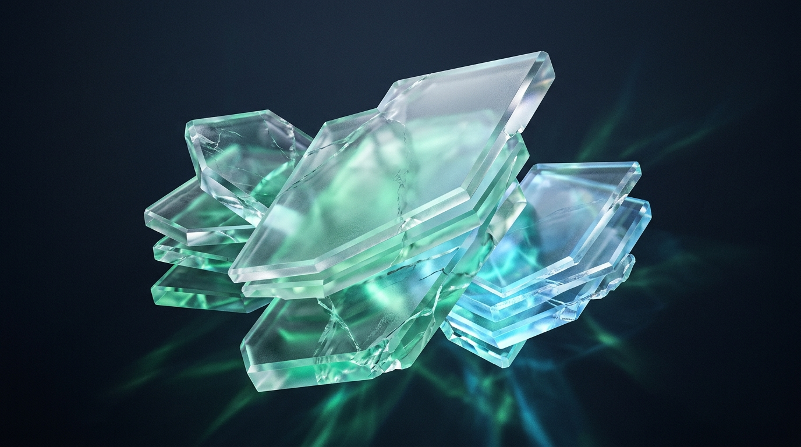
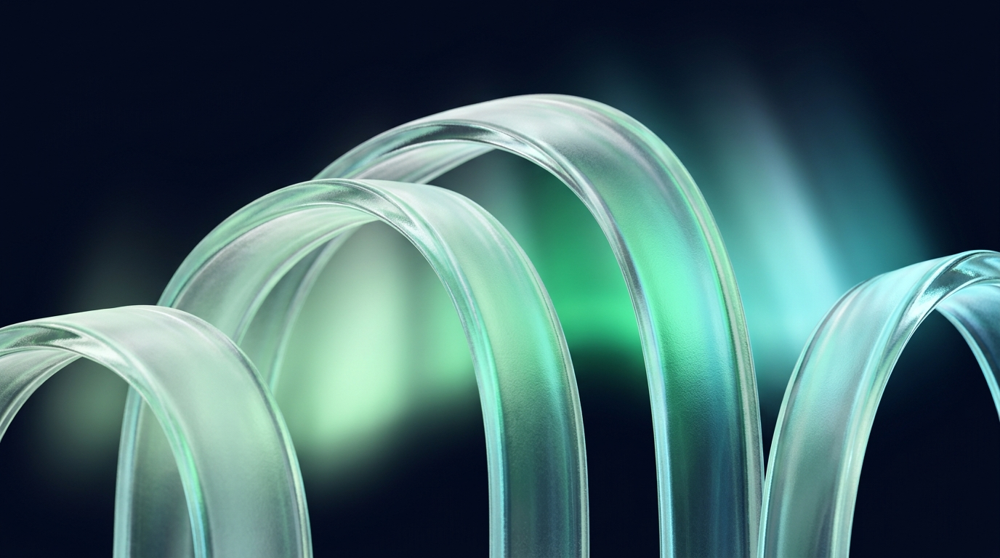

<div align="center">


<br />

# Luma OS 1.8.2 — **Fluorine · F-9 (`Base` & `Pro`)**

**Флагманская настольная оболочка нового поколения для Windows 10 / 11 в двух редакциях (`Base` и `Pro` с полными правами): полноценный универсальный второй экран «Luma AirDisplay» с нуля (работает при любых обстоятельствах без Miracast и драйверов на любом телефоне, планшете, ноутбуке, Mac, ПК или Smart TV + встроенный полноэкранный Приёмник по QR-коду и автопоиску ПК), гибкая Панель управления в стиле One UI 9.0 / Liquid Glass, Microsoft Word / Excel / PowerPoint на рабочем столе и системный экран блокировки по `Win + L`**

<p>
  <a href="https://github.com/Tveexty/L_H-3.0/releases/tag/v1.8.2"></a>
  
  
  
  
  
</p>

<h3>
  <a href="https://github.com/Tveexty/L_H-3.0/raw/main/LumaOS_1.8.2_Pro.exe">👑 Скачать LumaOS_1.8.2_Pro.exe (Pro · Полные права)</a>
  &nbsp;&nbsp;·&nbsp;&nbsp;
  <a href="https://github.com/Tveexty/L_H-3.0/raw/main/LumaOS_1.8.2_Base.exe">⬇️ Скачать LumaOS_1.8.2_Base.exe (Base)</a>
  <br />
  <a href="https://github.com/Tveexty/L_H-3.0/releases/tag/v1.8.2">📦 Релиз v1.8.2</a>
  &nbsp;&nbsp;·&nbsp;&nbsp;
  <a href="PATCH_NOTES_1.8.2.md">📝 Патч-ноут 1.8.2</a>
  &nbsp;&nbsp;·&nbsp;&nbsp;
  <a href="LumaOxygenConnect_Android/README.md">📱 Oxygen Connect (Android)</a>
  &nbsp;&nbsp;·&nbsp;&nbsp;
  <a href="luma_ai_nitrogen/README.md">🧠 Luma AI</a>
</h3>

</div>

> [!WARNING]
> **⚠️ Нестабильная работа версий `1.6.4` – `1.6.6b`!**
> Сборки **`1.6.4`**, **`1.6.5`**, **`1.6.6`** и **`1.6.6b`** работают **нестабильно** — **не используйте их**. Скачивайте актуальную версию **[Luma OS 1.8.2 Fluorine Pro / Base](https://github.com/Tveexty/L_H-3.0/releases/tag/v1.8.2)** (или финальную стабильную сборку ветки `1.6.x` — [`LumaOS_1.6.7.exe`](https://github.com/Tveexty/L_H-3.0/releases/tag/v1.6.7)).

---

## Что нового в **Luma OS 1.8.2 (Fluorine · F-9 · `Base` & `Pro`)**

| Раздел | Ключевые возможности и улучшения 1.8.2 |
| :--- | :--- |
| **📡 Luma AirDisplay — 2-й экран везде (без Miracast!)** | Написанный с нуля универсальный движок второго экрана: работает при любых обстоятельствах без Wi-Fi Direct, Miracast и драйверов — через Wi-Fi, кабель роутера, точку доступа или USB-модем на любом телефоне, планшете, iPad, ноутбуке, Mac, ПК или Smart TV прямо в браузере по QR-коду! |
| **👆 Полное удалённое управление и качество до 1080p 60 FPS** | Касания, режим тачпада, левый/правый/двойной клик, прокрутка, экранная клавиатура (Русский / English), живой курсор мыши, поворот `0°/90°/180°/270°`, выбор частоты (`15/24/30/60 FPS`), разрешения (до `1080p`) и защита 4-значным PIN-кодом. |
| **🧩 Умное разделение и «Виртуальный стол Luma»** | Трансляция любого физического монитора, всех мониторов сразу, умного разделения («Правая / Левая половина») или отдельного «Виртуального стола Luma» с часами, показателями ПК, заметками и быстрыми ссылками. |
| **🖥️ Встроенный Приёмник 2-го экрана (без Miracast)** | Превращает этот ПК во второй экран для любого телефона, ноутбука, Mac или другого ПК по QR-коду на весь экран + автопоиск других компьютеров с Luma OS в сети с живым управлением мышью и клавиатурой. |
| **📶 Мониторы + улучшенный Windows Miracast** | Список подключённых дисплеев, переключение режимов (`Дублировать / Расширить / Только ПК / Только 2-й`), исправление определения Miracast на русской Windows и установка компонента «Беспроводной дисплей» в 1 клик при полном сохранении всех прежних настроек. |

---

## Сравнение редакций **Luma OS 1.8.2 `Base` vs `Pro`**

| Функция / Права | `Luma OS 1.8.2 Base` | `Luma OS 1.8.2 Pro` |
| :--- | :---: | :---: |
| **Все новинки 1.8.2 (Luma AirDisplay 2-й экран везде, встроенный Приёмник, удалённое управление, Мониторы, улучшенный Miracast + все функции 1.8.1)** | ✅ Полностью | ✅ Полностью |
| **Права в Windows** | Пользователь (без UAC) | **Полные права Администратора (UAC)** |
| **Встроенный `Luma Photo Studio`** | До 2K · 12 шагов отмены | **До 4K · 30 шагов отмены · Pro-экспорт** |
| **Открытие фото и папок через Luma OS** | Внутри оболочки | **Внутри оболочки + ассоциации Windows** |
| **Панель управления (One UI 9.0 сетка + вертикальные ползунки + пресеты)** | ✅ | ✅ **Максимум опций** |
| **Суперустройство + Luma AirDisplay + Miracast + Circle to Search** | ✅ | ✅ **Pro-маршрутизация и игровой буст** |
| **Расширенная защита · SwapBoost · Стоп-зарядка · Плагины LumaCore 2.0** | Базовый режим | ✅ **Все Pro-модули разблокированы** |

---

## Галерея обоев **Fluorine 2.5D + Вся коллекция (25 встроенных артов + свои обои)**

> Все **25** обоев встроены прямо в `LumaOS_1.8_Pro.exe` и `LumaOS_1.8_Base.exe` (плюс безлимитное добавление своих картинок с диска).

<table>
  <tr>
    <td width="50%" align="center">
      
      <br />
      <b>Fluorine 1.8 — 2.5D Cryo-Emerald (Главные)</b>
    </td>
    <td width="50%" align="center">
      
      <br />
      <b>Fluorine 1.8 — 2.5D Crystal Prism</b>
    </td>
  </tr>
  <tr>
    <td width="50%" align="center">
      
      <br />
      <b>Fluorine 1.8 — 2.5D Liquid Waves</b>
    </td>
    <td width="50%" align="center">
      
      <br />
      <b>Fluorine 1.8 — 2.5D Glass Aurora</b>
    </td>
  </tr>
</table>

---

## Скачать Luma OS (все 53 сборки сохранены)

Все исполняемые файлы полностью автономны (установка не требуется — просто скачайте и запустите):

| Версия | Кодовое имя | Основные особенности | Прямая ссылка |
| :--- | :--- | :--- | :--- |
| **1.8.2 Pro (Рекомендуем)** | **Fluorine · F-9 Pro** | `👑 Полные права` · `📡 Luma AirDisplay 2-й экран везде (без Miracast!)` · `🖥️ Встроенный Приёмник по QR + автопоиск ПК` · `👆 Тач / Мышь / Клавиатура / 1080p 60 FPS` · `🧩 Сплит и Виртуальный стол` · `📶 Фикс Miracast + установка в 1 клик` | [**LumaOS_1.8.2_Pro.exe**](https://github.com/Tveexty/L_H-3.0/raw/main/LumaOS_1.8.2_Pro.exe) · [OTA (`LumaOS_1.8.2.exe`)](https://github.com/Tveexty/L_H-3.0/raw/main/LumaOS_1.8.2.exe) |
| **1.8.2 Base** | **Fluorine · F-9 Base** | `Стандартные права (без UAC)` · `Все новинки 1.8.2: универсальный второй экран Luma AirDisplay без Miracast, встроенный Приёмник, удалённое управление, Виртуальный стол, Мониторы и все функции 1.8.1` | [**LumaOS_1.8.2_Base.exe**](https://github.com/Tveexty/L_H-3.0/raw/main/LumaOS_1.8.2_Base.exe) |
| **1.8.1 Pro** | **Fluorine · F-9 Pro** | `🎛️ Конструктор Панели управления One UI 9.0 / Liquid Glass` · `🎨 Окраска панелей по теме` · `📄 MS Word/Excel/PowerPoint на стол` · `🔐 Экран блокировки Win+L + виджеты` · `📝 Оптимизация офиса` | [LumaOS_1.8.1_Pro.exe](https://github.com/Tveexty/L_H-3.0/raw/main/LumaOS_1.8.1_Pro.exe) · [OTA (`LumaOS_1.8.1.exe`)](https://github.com/Tveexty/L_H-3.0/raw/main/LumaOS_1.8.1.exe) |
| **1.8.1 Base** | **Fluorine · F-9 Base** | `Стандартные права (без UAC)` · `Конструктор Панели управления One UI 9.0, окраска панелей по теме, MS Office на рабочий стол, экран блокировки Win+L и оптимизация офиса` | [LumaOS_1.8.1_Base.exe](https://github.com/Tveexty/L_H-3.0/raw/main/LumaOS_1.8.1_Base.exe) |
| **1.8 Pro** | **Fluorine · F-9 Pro** | `👑 Полные права` · `🎨 4 новых 2.5D-обоев` · `⚙️ LumaCore 2.0 + Плагины` · `🪟 Оптический блюр + Fluent Reveal + Monet` · `🧩 +15 виджетов` · `🎛️ Панель (мышь/стилус/палец)` · `📝 Luma Word` · `💻 PowerShell из Поиска` | [LumaOS_1.8_Pro.exe](https://github.com/Tveexty/L_H-3.0/raw/main/LumaOS_1.8_Pro.exe) · [OTA (`LumaOS_1.8.exe`)](https://github.com/Tveexty/L_H-3.0/raw/main/LumaOS_1.8.exe) |
| **1.8 Base** | **Fluorine · F-9 Base** | `Стандартные права (без UAC)` · `Все новинки 1.8 Fluorine: 4 новых 2.5D-обоев, LumaCore 2.0, оптический блюр + Fluent Reveal + Monet, +15 виджетов, перетаскивание в Панели управления, Luma Word и PowerShell из Поиска` | [LumaOS_1.8_Base.exe](https://github.com/Tveexty/L_H-3.0/raw/main/LumaOS_1.8_Base.exe) |
| **1.7.5 Pro** | **Oxygen · Стиль ОС Pro** | `↩️ Прежний дизайн Пуска, Поиска и трея + чистые иконки приложений` · `◧/◫ Пуск слева или по центру` · `🧩 Скрытие модульной панели` · `📡 Miracast 2-й экран` | [LumaOS_1.7.5_Pro.exe](https://github.com/Tveexty/L_H-3.0/raw/main/LumaOS_1.7.5_Pro.exe) · [OTA (`LumaOS_1.7.5.exe`)](https://github.com/Tveexty/L_H-3.0/raw/main/LumaOS_1.7.5.exe) |
| **1.7.5 Base** | **Oxygen · Стиль ОС Base** | `Стандартные права (без UAC)` · `Привычный дизайн Пуска/Поиска/трея + выбор «Пуск слева / по центру» и Miracast` | [LumaOS_1.7.5_Base.exe](https://github.com/Tveexty/L_H-3.0/raw/main/LumaOS_1.7.5_Base.exe) |
| **1.7.4 Pro** | **Oxygen · Стиль ОС Pro** | `Чистые иконки приложений` · `Скрытие модульной панели и конструктора` · `Беспроводной 2-й экран Miracast` | [LumaOS_1.7.4_Pro.exe](https://github.com/Tveexty/L_H-3.0/raw/main/LumaOS_1.7.4_Pro.exe) · [OTA (`LumaOS_1.7.4.exe`)](https://github.com/Tveexty/L_H-3.0/raw/main/LumaOS_1.7.4.exe) |
| **1.7.4 Base** | **Oxygen · Стиль ОС Base** | `Стандартные права` · `Скрытие модульной панели` · `Беспроводной 2-й экран Miracast` | [LumaOS_1.7.4_Base.exe](https://github.com/Tveexty/L_H-3.0/raw/main/LumaOS_1.7.4_Base.exe) |
| **1.7.3 Pro** | **Oxygen · Стиль ОС Pro** | `Классическая + гибкая панель с перетаскиванием и выносом на стол` · `Меню ПКМ у курсора` · `120 Гц анимации` · `Свои обои` · `Компактная Панель «Стиль ОС»` · `Окно плеера` | [LumaOS_1.7.3_Pro.exe](https://github.com/Tveexty/L_H-3.0/raw/main/LumaOS_1.7.3_Pro.exe) · [OTA (`LumaOS_1.7.3.exe`)](https://github.com/Tveexty/L_H-3.0/raw/main/LumaOS_1.7.3.exe) |
| **1.7.3 Base** | **Oxygen · Стиль ОС Base** | `Стандартные права` · `Гибкая панель задач, вынос кнопок на стол, плавные анимации, свои обои, Панель «Стиль ОС» и окно плеера` | [LumaOS_1.7.3_Base.exe](https://github.com/Tveexty/L_H-3.0/raw/main/LumaOS_1.7.3_Base.exe) |
| **1.7.2B Pro** | **Oxygen · O-8 Pro** | `Фикс Circle to Search (без чёрного экрана ПК + Телефон · единые мозги распознавания)` · `Photo Studio 4K` · `Стиль ОС + Суперустройство` · `Фикс Alt+Tab` | [LumaOS_1.7.2B_Pro.exe](https://github.com/Tveexty/L_H-3.0/raw/main/LumaOS_1.7.2B_Pro.exe) · [OTA (`LumaOS_1.7.2B.exe`)](https://github.com/Tveexty/L_H-3.0/raw/main/LumaOS_1.7.2B.exe) |
| **1.7.2B Base** | **Oxygen · O-8 Base** | `Стандартные права` · `Фикс Circle to Search ПК + Телефон` · `Photo Studio` · `Стиль ОС + Суперустройство` | [LumaOS_1.7.2B_Base.exe](https://github.com/Tveexty/L_H-3.0/raw/main/LumaOS_1.7.2B_Base.exe) |
| **1.7.2 Pro** | **Oxygen · O-8 Pro** | `Luma Photo Studio 4K` · `Файлы через Luma OS` · `Модульная панель + прокрутка колесом` · `Стиль ОС + Суперустройство` · `Фикс Alt+Tab` | [LumaOS_1.7.2_Pro.exe](https://github.com/Tveexty/L_H-3.0/raw/main/LumaOS_1.7.2_Pro.exe) · [OTA (`LumaOS_1.7.2.exe`)](https://github.com/Tveexty/L_H-3.0/raw/main/LumaOS_1.7.2.exe) |
| **1.7.2 Base** | **Oxygen · O-8 Base** | `Стандартные права` · `Luma Photo Studio` · `Модульная панель` · `Стиль ОС + Суперустройство` | [LumaOS_1.7.2_Base.exe](https://github.com/Tveexty/L_H-3.0/raw/main/LumaOS_1.7.2_Base.exe) |
| **1.7.1** | **Oxygen · O-8** | `Волна передачи файлов Стиль ОС` · `1-Тап интерфейс телефона` · `Быстрый тачпад` · `Circle to Search` | [LumaOS_1.7.1.exe](https://github.com/Tveexty/L_H-3.0/raw/main/LumaOS_1.7.1.exe) |
| **1.7** | **Oxygen · O-8** | `100% иконки` · `Умный автозапуск` · `Правила окон` · `Полка Drag & Drop` · `Умный буфер` · `По-приложечный звук` · `Oxygen Connect` | [LumaOS_1.7.exe](https://github.com/Tveexty/L_H-3.0/raw/main/LumaOS_1.7.exe) |
| **1.6.7 (Финал 1.6.x)** | **Nitrogen · N-7** | `Фикс курсора и кликов Dynamic Island` · `Быстрый выбор файла в антивирусе без зависаний` | [LumaOS_1.6.7.exe](https://github.com/Tveexty/L_H-3.0/raw/main/LumaOS_1.6.7.exe) |
| ~~1.6.6b~~ *(нестаб.)* | Nitrogen · N-7 | *Нестабильная ветка 1.6.4–1.6.6b (используйте 1.8.2 / 1.6.7)* | [LumaOS_1.6.6b.exe](https://github.com/Tveexty/L_H-3.0/raw/main/LumaOS_1.6.6b.exe) |
| ~~1.6.6~~ *(нестаб.)* | Nitrogen · N-7 | *Нестабильная ветка 1.6.4–1.6.6b (используйте 1.8.2 / 1.6.7)* | [LumaOS_1.6.6.exe](https://github.com/Tveexty/L_H-3.0/raw/main/LumaOS_1.6.6.exe) |
| ~~1.6.5~~ *(нестаб.)* | Nitrogen · N-7 | *Нестабильная ветка 1.6.4–1.6.6b (используйте 1.8.2 / 1.6.7)* | [LumaOS_1.6.5.exe](https://github.com/Tveexty/L_H-3.0/raw/main/LumaOS_1.6.5.exe) |
| ~~1.6.4~~ *(нестаб.)* | Nitrogen · N-7 | *Нестабильная ветка 1.6.4–1.6.6b (используйте 1.8.2 / 1.6.7)* | [LumaOS_1.6.4.exe](https://github.com/Tveexty/L_H-3.0/raw/main/LumaOS_1.6.4.exe) |
| **1.6.3** | Nitrogen · N-7 | `Luma Ai Nitrogen` · `Стоп-зарядка батареи` · `Сенсор и стилус` · `Поверх окон` | [LumaOS_1.6.3.exe](https://github.com/Tveexty/L_H-3.0/raw/main/LumaOS_1.6.3.exe) |
| **1.6.2b** | Nitrogen · N-7 | `Встроенные Wi-Fi и Bluetooth` · `Замена горячих клавиш` | [LumaOS_1.6.2b.exe](https://github.com/Tveexty/L_H-3.0/raw/main/LumaOS_1.6.2b.exe) |
| **1.6.2** | Nitrogen · N-7 | `Luma AI 5.0` · `Обвести для поиска` · `Жесты и Спецвозможности` · `Корзина` | [LumaOS_1.6.2.exe](https://github.com/Tveexty/L_H-3.0/raw/main/LumaOS_1.6.2.exe) |
| **1.6.1** | Nitrogen · N-7 | `Сверхчистая панель` · `Luma AI 4.0` · `2.5D обои` · `Luma Nova` | [LumaOS_1.6.1.exe](https://github.com/Tveexty/L_H-3.0/raw/main/LumaOS_1.6.1.exe) |
| **1.6** | Nitrogen · N-7 | `Gamepad Studio` · `Deep Uninstaller` · `Luma Peek` · `Smart Dock` | [LumaOS_1.6.exe](https://github.com/Tveexty/L_H-3.0/raw/main/LumaOS_1.6.exe) |
| **1.5.4** | Carbon · C-6 | `Шторка уведомлений` · `140+ формул Excel` · `Уход за батареей` | [LumaOS_1.5.4.exe](https://github.com/Tveexty/L_H-3.0/raw/main/LumaOS_1.5.4.exe) |
| **1.5.3** | Carbon · C-6 | `Alt+Tab поверх окон` · `Luma Office Pro` · `Настройки сна` | [LumaOS_1.5.3.exe](https://github.com/Tveexty/L_H-3.0/raw/main/LumaOS_1.5.3.exe) |
| **1.5.2** | Carbon · C-6 | `Studios Pro` · `AI 3.0` · `100% перевод` | [LumaOS_1.5.2.exe](https://github.com/Tveexty/L_H-3.0/raw/main/LumaOS_1.5.2.exe) |
| **1.5.1** | Carbon · C-6 | `Office Studio` · `4K обои Carbon` | [LumaOS_1.5.1.exe](https://github.com/Tveexty/L_H-3.0/raw/main/LumaOS_1.5.1.exe) |
| **1.5** | Carbon · C-6 | `Приватный сейф` · `Code Studio` · `Cut Studio` | [LumaOS_1.5.exe](https://github.com/Tveexty/L_H-3.0/raw/main/LumaOS_1.5.exe) |
| **1.4** | Boron · B-5 | `Календарь` · `Мышь и DPI` · `SDK v3.0` | [LumaOS_1.4.exe](https://github.com/Tveexty/L_H-3.0/raw/main/LumaOS_1.4.exe) |
| **1.3.1** | Beryllium · Be-4 | `Мгновенная раскладка` · `Панель справа` | [LumaOS_1.3.1.exe](https://github.com/Tveexty/L_H-3.0/raw/main/LumaOS_1.3.1.exe) |
| **1.3** | Beryllium · Be-4 | `Заряд 2.4GHz мышек` · `VRAM в Диспетчере` | [LumaOS_1.3.exe](https://github.com/Tveexty/L_H-3.0/raw/main/LumaOS_1.3.exe) |
| **1.2.3B** | Lithium · Li-3 | `Сверхнизкая нагрузка ЦП` | [LumaOS_1.2.3B.exe](https://github.com/Tveexty/L_H-3.0/raw/main/LumaOS_1.2.3B.exe) |
| **1.2.3** | Lithium · Li-3 | `Интерактивные графики Диспетчера` · `Автоскрытие панели` | [LumaOS_1.2.3.exe](https://github.com/Tveexty/L_H-3.0/raw/main/LumaOS_1.2.3.exe) |
| **1.2.2** | Lithium · Li-3 | `120+ языков` · `Аудиовыходы` · `Откат версий` | [LumaOS_1.2.2.exe](https://github.com/Tveexty/L_H-3.0/raw/main/LumaOS_1.2.2.exe) |
| **1.2.1** | Lithium · Li-3 | `Автомасштаб экрана` · `Проводник Pro` | [LumaOS_1.2.1.exe](https://github.com/Tveexty/L_H-3.0/raw/main/LumaOS_1.2.1.exe) |
| **1.2.0** | Lithium · Li-3 | `Виртуальные столы` · `Калькулятор` · `Вечное сохранение` | [LumaOS_1.2.0.exe](https://github.com/Tveexty/L_H-3.0/raw/main/LumaOS_1.2.0.exe) |
| **1.1.0** | Helium · He-2 | `9 языков` · `Антивирус` · `Автообновление` | [LumaOS_1.1.0.exe](https://github.com/Tveexty/L_H-3.0/raw/main/LumaOS_1.1.0.exe) |
| **1.0.4** | Luma Classic | `Проводник` · `Диспетчер задач` · `8 тем` | [LumaOS_1.0.4.exe](https://github.com/Tveexty/L_H-3.0/raw/main/LumaOS_1.0.4.exe) |
| **1.0.3** | Luma Classic | `Базовый рабочий стол` | [LumaOS_1.0.3.exe](https://github.com/Tveexty/L_H-3.0/raw/main/LumaOS_1.0.3.exe) |
| **1.0.2b** | Luma Classic | `Первая сборка` | [LumaOS_1.0.2b.exe](https://github.com/Tveexty/L_H-3.0/raw/main/LumaOS_1.0.2b.exe) |

---

## Сборка редакций `Base` и `Pro` из исходников

```bash
npm install
npm run build

# Luma OS 1.8.2 Pro (полные права + все Pro-опции)
GOOS=windows GOARCH=amd64 CGO_ENABLED=0 go build -ldflags="-s -w -H=windowsgui -X main.KernelEdition=pro" -o LumaOS_1.8.2_Pro.exe .

# Luma OS 1.8.2 Base (обычная лёгкая версия)
GOOS=windows GOARCH=amd64 CGO_ENABLED=0 go build -tags luma_base -ldflags="-s -w -H=windowsgui -X main.KernelEdition=base" -o LumaOS_1.8.2_Base.exe .
```
