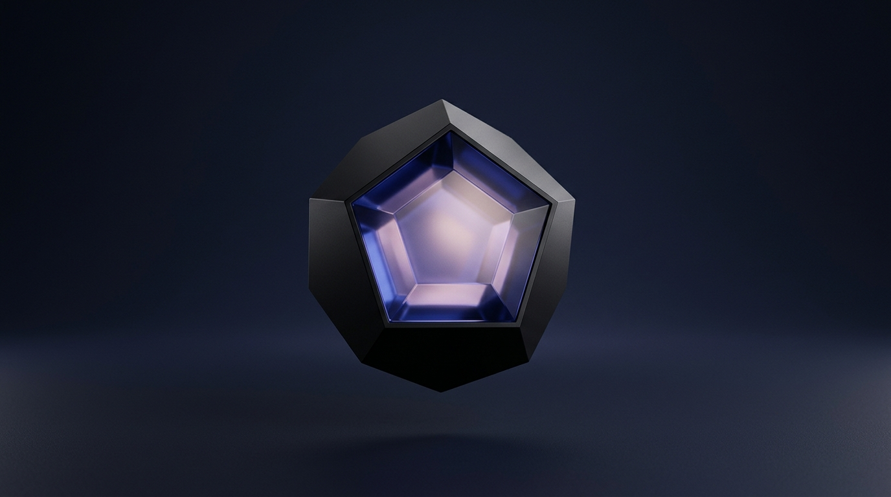
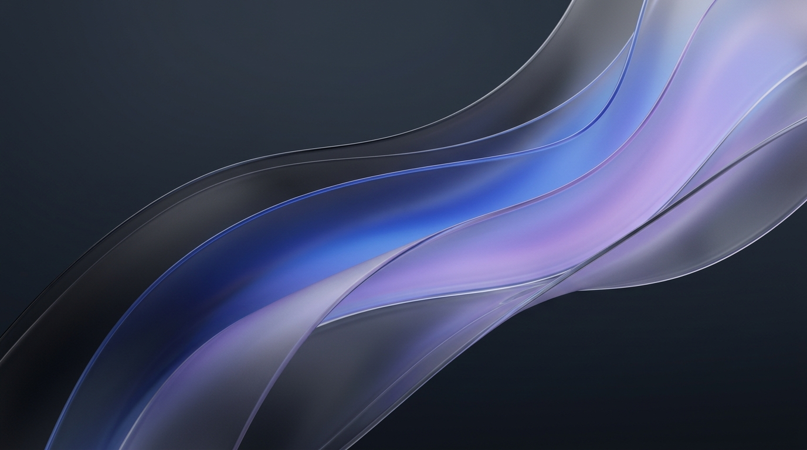

<div align="center">



<br />

# Luma OS 1.4 — **Boron · B-5**

**Настольная операционная среда нового поколения для Windows 10 / 11 на нативном Zero-WMI ядре `LumaCore 1.5` и модуле защиты `LumaShield 1.5`**

<p>
  <a href="https://github.com/Tveexty/L_H-3.0/releases/tag/v1.4"></a>
  
  
  
  
</p>

<h3>
  <a href="https://github.com/Tveexty/L_H-3.0/raw/main/LumaOS_1.4.exe">⬇️ Скачать LumaOS_1.4.exe (Portable · 1 файл · 0 зависимостей)</a>
  &nbsp;&nbsp;·&nbsp;&nbsp;
  <a href="https://github.com/Tveexty/L_H-3.0/releases/tag/v1.4">📦 Страница релиза v1.4</a>
</h3>

</div>

---

## Что нового в **Luma OS 1.4 (Boron · B-5)**

| Модуль | Ключевые возможности релиза 1.4 |
| :--- | :--- |
| **Календарь Luma OS** | Полноценное встроенное приложение: сетка месяца, события и напоминания с цветными тегами, лента ближайших дел, запуск по клику на часы в панели задач и интерактивный виджет месяца на рабочем столе. |
| **Полный сканер беспроводных мышек (BT / BLE / 2.4GHz)** | Переписанный глубокий HID/Bluetooth сканер `LumaCore 1.5` распознаёт **35+ брендов** (Logitech, Razer, SteelSeries, HyperX, Corsair, Keychron, Asus ROG, Attack Shark, Lamzu, Pulsar, Glorious, Ajazz, Redragon, Bloody, Apple, Sony, Microsoft и др.) и отображает все подключённые беспроводные устройства (BT, BLE и 2.4GHz радиоканал) даже если драйвер не передаёт процент заряда в Windows. |
| **Системный сервис «Мышь и DPI»** | Нативный Win32-контроллер скорости указателя и эффективного DPI (**eDPI**): слайдер скорости Windows `1–20`, калибровка сенсора `400–6400 DPI`, отключение акселерации (**Raw Input**), 5 быстрых пресетов (`Снайпер` / `Точность` / `Баланс` / `Игры` / `Ультра`), строки прокрутки колеса и живая тест-площадка отклика курсора. |
| **Developer SDK & Theme/Plugin API v3.0** | Открытый REST API (`/api/v3/sdk`, `/api/v3/themes`, `/api/v3/plugins`), глобальный браузерный SDK `window.LumaSDK` и встроенная **«Студия SDK v3.0»** прямо в окне Расширений — любой разработчик может создать, импортировать (`.luma-theme.json` / JSON-манифест плагина), экспортировать и применить свою тему или плагин за 1 клик. |
| **Ядро `LumaCore 1.5` + Защита `LumaShield 1.5`** | **85+ поведенческих правил безопасности** (+14 новых эвристик против инъекций, криптомайнеров и стилеров), встроенный **Аудит файла Hosts (DNS Hijack Protection)**, живой TCP-монитор, аудит автозагрузки и диагностика памяти ядра с очисткой RAM (GC Trim). |
| **Кинематографичная анимация обновления** | Полноэкранная 60 FPS GPU-анимация **Boron Cinema** с орбитальными кольцами `B-5`, светящимся ореолом прогресса, живой телеметрией скорости МБ/с, 4-этапной шкалой проверки SHA-256 и кнопкой **«Анимация обновления»** для предпросмотра в *Настройки → Обновления*. |
| **4 уникальных студийных арта обоев + 2 живых обоев** | Абсолютно новые студийные рендеры **Boron 1.4 (3D Prism)**, **Boron Dusk Horizon**, **Cobalt Silk Fold**, **Solar Eclipse Gold** и 2 плавных живых градиента (**Boron Sapphire**, **Cobalt Obsidian**). **Все обои прошлых версий полностью сохранены** — выбор с каждым релизом только растёт! |
| **Новые виджеты погоды, часов, энергии и календаря** | **«Погода на неделю (Арт · 7 дней)»** с живописными векторными иллюстрациями неба и реальным прогнозом Open-Meteo на 7 дней, **«Часы Студия Pro»** (Швейцарский хронограф, Стеклянный Флип, Двойной пояс), **«Энергия Boron (ПК + Мыши/BT)»** и **«Календарь (Месяц)»**. |
| **Прозрачность и фон каждого виджета** | Клик по любому виджету на рабочем столе (или *Настройки → Темы, Обои и Виджеты*) открывает настройку непрозрачности `0%–100%`, 7 режимов фона (`Тема` / `Стекло` / `Тёмный` / `Светлый` / `Акцент` / `Прозрачный` / `Свой цвет`), выбор цвета и силу размытия (`0 / 8 / 16 / 24 px`). |

---

## Галерея студийных обоев **Boron 1.4**

> Все обои встроены прямо в `LumaOS_1.4.exe` и дополняют полную коллекцию классических обоев (`Beryllium 1.3.1`, `Beryl Aurora`, `Amber Monolith`, `Lithium 1.2`, `Obsidian Silk`, `Helium 1.1` + 8 живых CSS-обоев).

<table>
  <tr>
    <td width="50%" align="center">
      
      <br />
      <b>Boron 1.4 — 3D Prism (B-5 Flagship)</b>
    </td>
    <td width="50%" align="center">
      
      <br />
      <b>Boron Dusk Horizon</b>
    </td>
  </tr>
  <tr>
    <td width="50%" align="center">
      
      <br />
      <b>Cobalt Silk Fold</b>
    </td>
    <td width="50%" align="center">
      
      <br />
      <b>Solar Eclipse Gold</b>
    </td>
  </tr>
</table>

---

## Developer SDK v3.0 — Создавайте свои темы и плагины

В **Luma OS 1.4 (Boron)** открыт единый **Developer SDK v3.0** с сохранением пользовательских тем и плагинов на диске (`~/.config/LumaOS/sdk_v3/`).

### 1. REST API ядра `LumaCore 1.5`

| Метод и эндпоинт | Назначение |
| :--- | :--- |
| `GET /api/v3/sdk` | Манифест SDK v3.0, список хуков и доступных эндпоинтов |
| `GET / POST / DELETE /api/v3/themes` | Чтение, установка и удаление пользовательских тем оформления |
| `GET / POST / DELETE /api/v3/plugins` | Чтение, установка и удаление пользовательских плагинов |
| `GET / POST /api/kernel/mouse/dpi` | Чтение и изменение скорости указателя Windows / eDPI / Raw Input |
| `GET /api/kernel/wireless/batteries?refresh=1` | Сканер Bluetooth, BLE и 2.4GHz радиоканальных мышек/гарнитур |
| `GET /api/kernel/security/hosts-audit` | Аудит системного файла `hosts` (DNS Hijack Protection) |
| `GET /api/kernel/diagnostics?gc=1` | Диагностика памяти ядра и принудительная очистка GC |

### 2. Быстрый старт через `window.LumaSDK` (JS / DevTools / Студия SDK v3.0)

```js
// Зарегистрировать и сразу применить собственную тему оформления
await window.LumaSDK.registerTheme({
  id: 'my_midnight_boron',
  name: 'Midnight Boron',
  description: 'Авторская тёмная тема с сапфировым акцентом',
  isDark: true,
  bgGradient: 'linear-gradient(155deg, #050814 0%, #111a3a 55%, #080c1c 100%)',
  surfaceRgba: 'rgba(13, 18, 34, 0.90)',
  cardHex: '#131c36',
  accent: 'indigo',
  accentHex: '#818cf8',
}, true);

// Зарегистрировать пользовательский плагин SDK v3.0
await window.LumaSDK.registerPlugin({
  id: 'my_dev_plugin',
  name: 'Dev Telemetry Pulse',
  version: '1.0.0',
  apiVersion: '3.0',
  author: 'Your Name',
  category: 'Инструменты',
  icon: 'Zap',
  description: 'Показывает системное уведомление с состоянием ядра',
  enabled: true,
  hooks: ['onBoot', 'onAction'],
  permissions: ['notify', 'telemetry.read'],
  actionId: 'custom_sdk_v3',
});

window.LumaSDK.notify('Developer SDK v3.0', 'Тема и плагин успешно установлены!', 'success');
```

---

## Горячие клавиши

| Комбинация | Действие |
| :--- | :--- |
| `Alt + R` / `Ctrl + K` | **Luma Search** — мгновенный поиск приложений ПК, настроек, служб и веба |
| `Alt + Shift` / `Win + Space` | Мгновенная смена раскладки клавиатуры (0 мс задержки на панели задач) |
| `Alt + W` | Обзор открытых окон и виртуальных рабочих столов |
| `Alt + D` | Свернуть все окна / показать рабочий стол |
| `F11` | Полноэкранный режим оболочки |
| `Ctrl + Alt + Shift + W` | Экстренное восстановление системной панели задач Windows |

---

## Скачать Luma OS (все сборки)

Все исполняемые файлы автономны (**Single-Binary Portable EXE** — встроенный фронтенд + Go-ядро, установка не требуется):

| Версия | Кодовое имя | Ядро / Защита | Прямая ссылка |
| :--- | :--- | :--- | :--- |
| **1.4 (Актуальная)** | **Boron · B-5** | `LumaCore 1.5` · `LumaShield 1.5` · `SDK v3.0` | [**LumaOS_1.4.exe**](https://github.com/Tveexty/L_H-3.0/raw/main/LumaOS_1.4.exe) |
| **1.3.1** | Beryllium · Be-4 | `LumaCore 1.4` · `LumaShield 1.4` | [LumaOS_1.3.1.exe](https://github.com/Tveexty/L_H-3.0/raw/main/LumaOS_1.3.1.exe) |
| **1.3** | Beryllium · Be-4 | `LumaCore 1.4` · `LumaShield 1.4` | [LumaOS_1.3.exe](https://github.com/Tveexty/L_H-3.0/raw/main/LumaOS_1.3.exe) |
| **1.2.3B** | Lithium · Li-3 | `LumaCore 1.3B` (True Zero-WMI) | [LumaOS_1.2.3B.exe](https://github.com/Tveexty/L_H-3.0/raw/main/LumaOS_1.2.3B.exe) |
| **1.2.3** | Lithium · Li-3 | `LumaCore 1.3` · `LumaShield 1.3` | [LumaOS_1.2.3.exe](https://github.com/Tveexty/L_H-3.0/raw/main/LumaOS_1.2.3.exe) |
| **1.2.2** | Lithium · Li-3 | `LumaCore 1.2.2` · `LumaShield 1.3` | [LumaOS_1.2.2.exe](https://github.com/Tveexty/L_H-3.0/raw/main/LumaOS_1.2.2.exe) |
| **1.2.1** | Lithium · Li-3 | `LumaCore 1.2` | [LumaOS_1.2.1.exe](https://github.com/Tveexty/L_H-3.0/raw/main/LumaOS_1.2.1.exe) |
| **1.2** | Lithium · Li-3 | `LumaCore 1.2` | [LumaOS_1.2.exe](https://github.com/Tveexty/L_H-3.0/raw/main/LumaOS_1.2.exe) |
| **1.1** | Helium · He-2 | `LumaCore 1.1` | [LumaOS_1.1.exe](https://github.com/Tveexty/L_H-3.0/raw/main/LumaOS_1.1.exe) |
| **1.0.4** | Classic DeX | `LumaCore 1.0` | [LumaOS_1.0.4.exe](https://github.com/Tveexty/L_H-3.0/raw/main/LumaOS_1.0.4.exe) |

> Встроенный менеджер **Настройки → Обновления и Откат** позволяет в 1 клик обновиться до новой версии через GitHub OTA или откатиться на любую предыдущую сборку с полным сохранением виджетов, ярлыков и настроек.

---

## Сборка из исходного кода

```bash
# 1. Установка зависимостей и сборка UI (React + TypeScript + Tailwind + Vite)
npm install
npm run build

# 2. Сборка автономного Windows EXE (встраивает dist/ через go:embed)
GOOS=windows GOARCH=amd64 CGO_ENABLED=0 go build -ldflags="-s -w -H=windowsgui" -o LumaOS_1.4.exe .
```

<div align="center">
  <br />
  <sub>Создано с любовью к скорости, чистому дизайну и контролю над системой · <b>Luma OS 1.4 (Boron · B-5)</b></sub>
</div>
