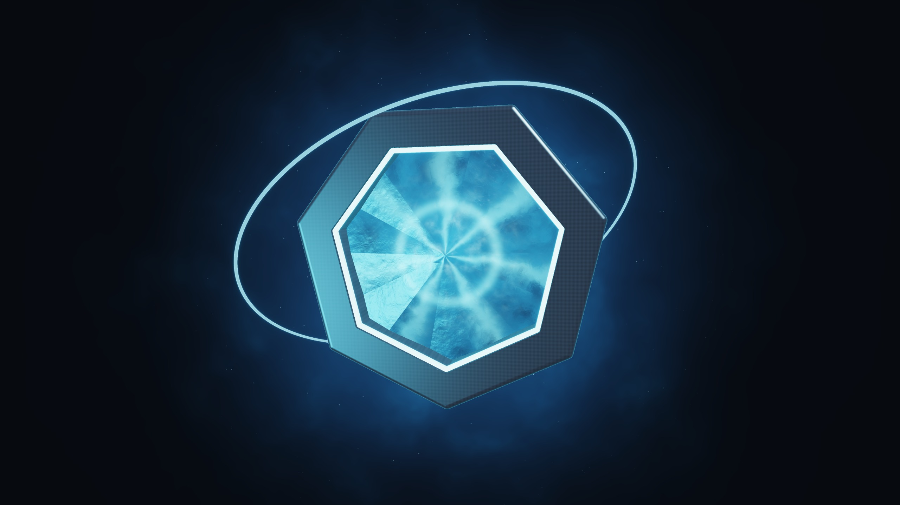
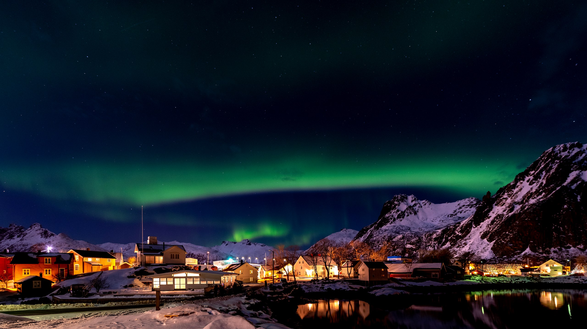

<div align="center">



<br />

# Luma OS 1.6 — **Nitrogen · N-7**

**Флагманская настольная операционная среда для Windows 10 / 11 на ядре `LumaCore 1.5.0` и защите `LumaShield 2.5` (235+ правил), с новым системным стилем «Ubuntu», режимами Разработчика и Администратора, бережной «Виртуальной памятью» RAM Plus (2 / 4 / 6 ГБ с расчётом TBW), обновлённой `Luma AI 3.8 FlashLite` с проверенными источниками во всех приложениях, «Поверх всех окон» (`📌`), `Luma Gamepad Studio` (аналог DS4Windows), 4-этапной очисткой хвостов программ, `Quick Look` по `Space`, системным перехватом клавиши `Win`, исправленным `Alt + Tab` на рабочем столе и Умным Dock со стеками папок и прогресс-барами загрузок Steam и браузеров**

<p>
  <a href="https://github.com/Tveexty/L_H-3.0/releases/tag/v1.6"></a>
  
  
  
  
  
</p>

<h3>
  <a href="https://github.com/Tveexty/L_H-3.0/raw/main/LumaOS_1.6.exe">⬇️ Скачать LumaOS_1.6.exe (Portable · 1 файл · 0 зависимостей)</a>
  &nbsp;&nbsp;·&nbsp;&nbsp;
  <a href="https://github.com/Tveexty/L_H-3.0/releases/tag/v1.6">📦 Страница релиза v1.6</a>
</h3>

</div>

---

## Что нового в **Luma OS 1.6 (Nitrogen · N-7 · Ядро `LumaCore 1.5.0` · `LumaShield 2.5`)**

| № | Модуль | Ключевые возможности обновления 1.6 |
| :---: | :--- | :--- |
| **1** | **Коллекция реалистичных обоев «Nitrogen» (QHD)** | 6 новых высокодетализированных обоев (`Nitrogen Hero`, `Aurora`, `Glacier`, `Alpine`, `Fjord`, `Arctic`) + 2 живых градиентных фона (`Nitrogen Cryo-Plasma` и `Arctic Aurora Ice`) при полном сохранении всех обоев из всех предыдущих версий. |
| **2** | **Режим разработчика (`Ctrl + Shift + D`) и Режим Администратора** | Живой перетаскиваемый **Developer HUD** с FPS, памятью JS/Go Heap, числом горутин, задержкой IPC и инспектором DOM-элементов. Определение статуса **Администратора Windows (UAC)** и перезапуск с повышением прав (`ShellExecuteW runas`) в 1 клик. |
| **3** | **Новый стиль системы «Ubuntu»** | Убирает кнопку «Пуск» с панели задач; в правом верхнем углу появляется компактная капсула **Батарея · Wi-Fi · Язык**, открывающая фирменную панель Ubuntu с компактным лаунчером/Пуском, переключателем окон рабочего стола, поиском `Alt + R`, рабочими столами, ползунками звука/яркости и питанием. |
| **4** | **Виртуальная память (RAM Plus: 2 / 4 / 6 ГБ) с заботой об SSD** | Фиксированный `pagefile.sys` (`Min == Max`, без фрагментации), активация **Windows Memory Compression**, `ClearPageFileAtShutdown = 0` и живой калькулятор износа накопителя (**TBW / суточная запись / запас ресурса**). |
| **5** | **Ядро `LumaCore 1.5.0` (`1.6.0`) и `LumaShield 2.5`** | **235+ эвристических и сигнатурных правил**, глубокий аудит автозагрузки (реестр + папки Startup) и **Планировщика задач Windows** (`/api/kernel/security/tasks-audit`), нулевая утечка Win32-колбэков (`syscall.NewCallback` строго синглтоны). |
| **6** | **Luma AI 3.8 FlashLite с проверенными источниками** | Параллельный поиск фактов в **Wikipedia (RU/EN)**, **DuckDuckGo**, **MDN**, **GitHub**, **Open-Meteo**, **ЦБ РФ** + живая телеметрия ПК с кликабельными карточками источников. Кнопка **`AI 3.8`** встроена в **Luma Office** (Word/Excel/PowerPoint), **Code Studio**, **Терминал** (команда `ai <вопрос>`), **Quick Look / Проводник** и поиск **`Alt + R`**. |
| **7** | **«Поверх всех окон» (`📌 Always on Top`)** | Кнопка `📌` в заголовке каждого из 21 окна Luma OS (`DexWindow`) и закрепление любых внешних окон Windows через Win32 `SetWindowPos(HWND_TOPMOST / HWND_NOTOPMOST)` прямо из `Alt + Tab` и меню панели задач. |
| **8** | **Luma Gamepad Studio (аналог DS4Windows)** | Поддержка **DualShock 4**, **DualSense**, **Xbox (XInput)** и **HID**, живой 60 FPS визуализатор осей и кнопок, профили, мёртвые зоны и кривые отклика стиков/триггеров, **RGB Lightbar**, тест вибрации, частота опроса (`125–1000 Гц`) и эмуляция мыши/клавиатуры. |
| **9** | **Встроенная очистка хвостов программ (Revo / BCUninstaller)** | Список установленных программ Windows, запуск штатного деинсталлятора, **4-этапный сканер остатков** (`AppData`/`LocalAppData`/`ProgramData`/`Program Files`/`Temp`, ветки реестра `HKCU`/`HKLM`, службы и задачи), выбор галочками, **автобэкап** и безопасное восстановление. |
| **10** | **Quick Look по клавише `Space`** | Мгновенный предпросмотр в **Проводнике** (включая все параллельные шторки), на **Рабочем столе** и в **стеках Умного Dock**: фото с зумом и поворотом, видео и аудио с **HTTP Range 206** стримингом, код/текст с подсветкой синтаксиса + объяснение через **AI 3.8**, PDF и Markdown; перелистывание соседних файлов стрелками `← / →` и закрытие по `Space` / `Esc`. |
| **11** | **Клавиша `Win` → Luma OS Start / Панель Ubuntu** | Короткое одиночное нажатие клавиши `Win` открывает меню Пуск Luma OS (или компактную панель Ubuntu в стиле Ubuntu) вместо стандартного Пуска Windows, полностью сохраняя системные комбинации `Win + D`, `Win + L`, `Win + Shift + S`, `Win + Space`, `Win + E`. |
| **12** | **Исправленный `Alt + Tab` на рабочем столе** | Уверенный перевод фокуса WebView2 поверх Luma Desktop и Windows Desktop, сквозной проброс стрелок/`Enter`/`Esc` из низкоуровневого хука (`luma-alt-tab-nav`), монотонный счётчик сессий и защита от двойного переключения. |
| **13** | **Умный Dock: стеки папок, бейджи и прогресс загрузок** | Стеки папок (**Веер / Сетка**) с открытием, `Quick Look` по `Space` и перетаскиванием; живые бейджи уведомлений на иконках мессенджеров; живые прогресс-бары загрузок/установок прямо на иконках — реальный парсинг **Steam** (`libraryfolders.vdf` + `appmanifest_*.acf`), браузерных `.crdownload`/`.part`/`.opdownload` и внутренних задач Luma с цветами состояний (*активно / распаковка / пауза / ошибка*). |

---

## Галерея реалистичных обоев **Nitrogen (QHD 2560×1440)**

> Все обои встроены в `LumaOS_1.6.exe` и дополняют полную накопительную коллекцию всех предыдущих версий (`Carbon 1.5`, `Boron 1.4`, `Beryllium 1.3.1`, `Lithium 1.2`, `Obsidian Silk`, `Helium 1.1` + 12 живых CSS-обоев).

<table>
  <tr>
    <td width="33%" align="center">
      
      <br />
      <b>Nitrogen N-7 — Cryo-Sapphire Hero</b>
    </td>
    <td width="33%" align="center">
      
      <br />
      <b>Nitrogen Aurora — Northern Lights</b>
    </td>
    <td width="33%" align="center">
      
      <br />
      <b>Nitrogen Glacier — Ice Ridge</b>
    </td>
  </tr>
  <tr>
    <td width="33%" align="center">
      
      <br />
      <b>Nitrogen Alpine — Dusk Peaks</b>
    </td>
    <td width="33%" align="center">
      
      <br />
      <b>Nitrogen Fjord — Nordic Mist</b>
    </td>
    <td width="33%" align="center">
      
      <br />
      <b>Nitrogen Arctic — Liquid Horizon</b>
    </td>
  </tr>
</table>

---

## Новые API ядра `LumaCore 1.5.0` (`v1.6.0`)

| Метод и эндпоинт | Назначение |
| :--- | :--- |
| `GET /api/kernel/dev/metrics` · `GET / POST /api/kernel/admin/status\|elevate` | Живая телеметрия Developer HUD и статус/перезапуск с UAC (`runas`) |
| `GET / POST /api/kernel/vmem/status\|configure` | Виртуальная память RAM Plus (`2 / 4 / 6 ГБ`, `Min == Max`, сжатие памяти, расчёт TBW) |
| `GET /api/kernel/security/status` · `GET /api/kernel/security/tasks-audit` | Антивирус **LumaShield 2.5** (235+ правил) + аудит автозагрузки и Планировщика задач |
| `POST /api/kernel/ai/chat` · `POST /api/kernel/ai/assist` | **Luma AI 3.8 FlashLite** (Wikipedia RU/EN, DuckDuckGo, MDN, GitHub, Open-Meteo, ЦБ РФ + источники) |
| `GET / POST /api/kernel/windows/topmost` | Win32 `SetWindowPos(HWND_TOPMOST / HWND_NOTOPMOST)` для любых окон Windows |
| `GET / POST /api/kernel/gamepad/state\|profiles\|lightbar\|rumble\|emulation` | **Luma Gamepad Studio** (DS4 / DualSense / XInput / HID, профили, RGB, вибрация, эмуляция) |
| `GET / POST /api/kernel/uninstaller/programs\|run\|scan\|clean\|backups\|restore` | 4-этапная очистка хвостов программ с автобэкапом и откатом |
| `GET /api/kernel/fs/quicklook` · `GET /api/kernel/fs/raw` (`HTTP 206 Range`) | **Quick Look** предпросмотр файлов и потоковый медиа-сервер с поддержкой `Range` |
| `GET / POST /api/kernel/win-key/toggle` · `POST /api/kernel/alt-tab/toggle` | Перехват одиночного нажатия `Win` (с сохранением `Win+D/L/E/Space/Shift+S`) и исправленный `Alt + Tab` |
| `GET / POST /api/kernel/dock/status\|stack\|stacks\|task` | **Умный Dock** (стеки папок, бейджи мессенджеров, реальный парсер Steam ACF + браузеров + задач Luma) |

---

## Горячие клавиши

| Комбинация | Действие |
| :--- | :--- |
| `Win` (одиночное нажатие) | Открывает **Меню Пуск Luma OS** (или компактную панель **Ubuntu** в стиле Ubuntu) |
| `Space` (Проводник / Шторки / Рабочий стол / Стеки) | **Quick Look** — мгновенный предпросмотр файла (`← / →` соседние файлы, `Space`/`Esc` закрыть) |
| `Ctrl + Shift + D` | Включить / выключить **Developer HUD** (FPS / RAM / IPC / DOM-инспектор) |
| `Alt + Tab` (или `Alt + Q`) | **Умный переключатель окон Luma OS** (MRU, живые превью, `📌 Поверх всех окон`, стрелки/`Enter`/`Esc`) |
| `Win + D` | Мгновенный возврат на главный экран **Luma OS** |
| `Alt + N` | **Шторка уведомлений** (кто, что и когда написал) |
| `Alt + R` / `Ctrl + K` | **Luma Search + AI 3.8** — мгновенный поиск приложений, настроек и ответы AI с источниками |
| `Tab` (или правый верхний угол) | Панель управления Carbon / компактная панель **Ubuntu** |
| `Ctrl + Shift + S` | Мгновенная остановка Zero-Freeze записи экрана |
| `Ctrl + Alt + Shift + W` | Экстренное восстановление системной панели задач Windows |

---

## Скачать Luma OS (все 18 сборок сохранены)

Все исполняемые файлы автономны (**Single-Binary Portable EXE** — встроенный фронтенд + Go-ядро, установка не требуется):

| Версия | Кодовое имя | Ядро / Защита | Прямая ссылка |
| :--- | :--- | :--- | :--- |
| **1.6 (Актуальная)** | **Nitrogen · N-7** | `LumaCore 1.5.0` · `LumaShield 2.5` · `AI 3.8` · `Ubuntu` · `Gamepad Studio` · `Uninstaller` · `Quick Look` · `Smart Dock` | [**LumaOS_1.6.exe**](https://github.com/Tveexty/L_H-3.0/raw/main/LumaOS_1.6.exe) |
| **1.5.4** | Carbon · C-6 | `LumaCore 1.4.7` · `24/7 Stability` · `Шторка` · `140+ Excel` · `Battery Care` | [LumaOS_1.5.4.exe](https://github.com/Tveexty/L_H-3.0/raw/main/LumaOS_1.5.4.exe) |
| **1.5.3** | Carbon · C-6 | `LumaCore 1.4.6` · `Topmost Alt+Tab` · `MS-style Office` · `Idle Sleep` | [LumaOS_1.5.3.exe](https://github.com/Tveexty/L_H-3.0/raw/main/LumaOS_1.5.3.exe) |
| **1.5.2** | Carbon · C-6 | `LumaCore 1.4.5` · `LumaShield 2.0` · `Studios Pro` · `AI 3.0` | [LumaOS_1.5.2.exe](https://github.com/Tveexty/L_H-3.0/raw/main/LumaOS_1.5.2.exe) |
| **1.5.1** | Carbon · C-6 | `LumaCore 1.6.1` · `LumaShield 2.0` · `Office Studio` | [LumaOS_1.5.1.exe](https://github.com/Tveexty/L_H-3.0/raw/main/LumaOS_1.5.1.exe) |
| **1.5** | Carbon · C-6 | `LumaCore 1.6` · `LumaShield 1.6` · `AES-256 Vault` | [LumaOS_1.5.exe](https://github.com/Tveexty/L_H-3.0/raw/main/LumaOS_1.5.exe) |
| **1.4** | Boron · B-5 | `LumaCore 1.5` · `LumaShield 1.5` · `SDK v3.0` | [LumaOS_1.4.exe](https://github.com/Tveexty/L_H-3.0/raw/main/LumaOS_1.4.exe) |
| **1.3.1** | Beryllium · Be-4 | `LumaCore 1.4` · `LumaShield 1.4` | [LumaOS_1.3.1.exe](https://github.com/Tveexty/L_H-3.0/raw/main/LumaOS_1.3.1.exe) |
| **1.3** | Beryllium · Be-4 | `LumaCore 1.4` · `LumaShield 1.4` | [LumaOS_1.3.exe](https://github.com/Tveexty/L_H-3.0/raw/main/LumaOS_1.3.exe) |
| **1.2.3B** | Lithium · Li-3 | `LumaCore 1.3B` (True Zero-WMI) | [LumaOS_1.2.3B.exe](https://github.com/Tveexty/L_H-3.0/raw/main/LumaOS_1.2.3B.exe) |
| **1.2.3** | Lithium · Li-3 | `LumaCore 1.3` · `LumaShield 1.3` | [LumaOS_1.2.3.exe](https://github.com/Tveexty/L_H-3.0/raw/main/LumaOS_1.2.3.exe) |
| **1.2.2** | Lithium · Li-3 | `LumaCore 1.2.2` · `LumaShield 1.3` | [LumaOS_1.2.2.exe](https://github.com/Tveexty/L_H-3.0/raw/main/LumaOS_1.2.2.exe) |
| **1.2.1** | Lithium · Li-3 | `LumaCore 1.2` | [LumaOS_1.2.1.exe](https://github.com/Tveexty/L_H-3.0/raw/main/LumaOS_1.2.1.exe) |
| **1.2.0** | Lithium · Li-3 | `LumaCore 1.2` | [LumaOS_1.2.0.exe](https://github.com/Tveexty/L_H-3.0/raw/main/LumaOS_1.2.0.exe) |
| **1.1.0** | Helium · He-2 | `LumaCore 1.1` | [LumaOS_1.1.0.exe](https://github.com/Tveexty/L_H-3.0/raw/main/LumaOS_1.1.0.exe) |
| **1.0.4** | Classic DeX | `LumaCore 1.0` | [LumaOS_1.0.4.exe](https://github.com/Tveexty/L_H-3.0/raw/main/LumaOS_1.0.4.exe) |
| **1.0.3** | Classic DeX | `LumaCore 1.0` | [LumaOS_1.0.3.exe](https://github.com/Tveexty/L_H-3.0/raw/main/LumaOS_1.0.3.exe) |
| **1.0.2b** | Classic DeX | `LumaCore 1.0` | [LumaOS_1.0.2b.exe](https://github.com/Tveexty/L_H-3.0/raw/main/LumaOS_1.0.2b.exe) |

---

## Сборка из исходников

```bash
npm install
npm run build
GOOS=windows GOARCH=amd64 CGO_ENABLED=0 go build -ldflags="-s -w -H=windowsgui" -o LumaOS_1.6.exe .
```
