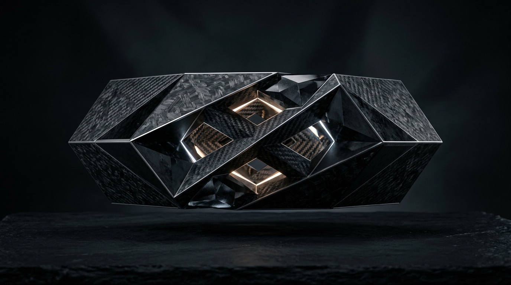

<div align="center">



<br />

# Luma OS 1.5.3 — **Carbon · C-6**

**Флагманская настольная операционная среда для Windows 10 / 11 на ядре `LumaCore 1.4.6`, с фирменным `Alt + Tab` поверх всех окон, `Win + D` возвратом в Luma OS, 4-слойным перехватом входящих сообщений, аутентичным Microsoft-стилем `Luma Office` (`Word` · `Excel` · `PowerPoint`) и настройками сна при бездействии**

<p>
  <a href="https://github.com/Tveexty/L_H-3.0/releases/tag/v1.5.3"></a>
  
  
  
  
  
</p>

<h3>
  <a href="https://github.com/Tveexty/L_H-3.0/raw/main/LumaOS_1.5.3.exe">⬇️ Скачать LumaOS_1.5.3.exe (Portable · 1 файл · 0 зависимостей)</a>
  &nbsp;&nbsp;·&nbsp;&nbsp;
  <a href="https://github.com/Tveexty/L_H-3.0/releases/tag/v1.5.3">📦 Страница релиза v1.5.3</a>
</h3>

</div>

---

## Что нового в **Luma OS 1.5.3 (Carbon · C-6 · Ядро `1.4.6`)**

| Модуль | Ключевые улучшения обновления 1.5.3 |
| :--- | :--- |
| **Фирменный `Alt + Tab` поверх ВСЕХ окон + `Win + D` → Luma OS** | Переработанный Win32 `WH_KEYBOARD_LL` перехватчик с `AttachThreadInput` и временным `HWND_TOPMOST` мгновенно открывает стеклянный **Luma Switcher** поверх Chrome, Telegram и любых приложений Windows. На первом месте — карточка **«Главная · Luma OS»** с живыми часами и превью обоев; нажатие **`Win + D`** полностью заменено на мгновенный возврат на главный экран Luma OS. |
| **4-слойный гарантированный перехват входящих сообщений** | Полностью устранены задержки NTFS `ModTime` и пропуски сообщений в Windows WPN (`CreateFileW` с `FILE_SHARE_READ\|WRITE\|DELETE`), добавлен перехват **нативных всплывающих окон Telegram Desktop** (работает даже без включения системных уведомлений Windows!), строгий дельта-детектор (`+1` новое сообщение без спама), всплывающая кликабельная карточка с круглой аватаркой и звуковой сигнал. |
| **Luma Office 1.5.3 — аутентичный интерфейс Word, Excel и PowerPoint** | **20× больше функций и 100% знакомое расположение кнопок**: фирменные цветные шапки (`Word #185ABD`, `Excel #107C41`, `PowerPoint #B7472A`), подписанные группы ленты **Ribbon**, меню **«Файл» (Backstage)** с шаблонами и строка поиска инструментов (**Tell Me**). **Word**: 7 вкладок, интерактивная сетка таблиц `10×8`, Формат по образцу, уравнения/символы, сантиметровая линейка, навигация по заголовкам, типографика, озвучка текста и примечания. **Excel**: **55+ формул на русском и английском** (`СУММ`/`SUM`, `ВПР`/`VLOOKUP`, `ЕСЛИ`/`IF`, `СЧЁТЕСЛИ`/`COUNTIF`, `ПЛТ`/`PMT`, `МЕДИАНА`), маркер автозаполнения (**Fill Handle**), сводные таблицы, условное форматирование с гистограммами, **6 типов графиков**, автофильтр и живая строка состояния `Среднее · Количество · Сумма`. **PowerPoint**: 8 вкладок, 9 макетов, 15+ фигур, SmartArt, рисование пером/маркером на слайдах, 12 тем, 10 переходов, 10 анимаций, Сортировщик слайдов и **режим докладчика F5 с лазерной указкой**. |
| **Сон и выключение экрана при бездействии (в «Питание и Батарея»)** | Прямая синхронизация с активной схемой электропитания Windows (**`powrprof.dll`**): отдельные таймеры выключения экрана и перехода в сон для работы **От сети (AC — ПК)** и **От батареи (DC — Ноутбук)**, гибернация, блокировка перед сном, живой счётчик бездействия (`GetLastInputInfo`), защита от сна при видео/записи и режим **«Кофеин» (`SetThreadExecutionState`)**. |

---

## Что нового было в **Luma OS 1.5.2 (Carbon · C-6 · Ядро `1.4.5`)**

| Модуль | Ключевые улучшения и исправления обновления 1.5.2 |
| :--- | :--- |
| **Zero-Freeze запись экрана (`LumaCore 1.4.5`)** | Полностью исправлен критический баг зависания ПК при запуске записи экрана: внедрён нативный фоновый Go AVI-рекордер (`~/Videos/LumaRecordings`) без блокировки WebView2/Topmost, безопасное снятие Topmost для резервного захвата и мгновенная остановка по **`Ctrl + Shift + S`**. |
| **Чистые входящие сообщения Telegram / WhatsApp / Discord** | Убран спам со счётчиками непрочитанных (`3048413 непрочит.`). Мост Windows WPN DB/WAL теперь фильтрует только **реальные входящие сообщения от пользователей**, извлекает **круглые аватарки**, имя отправителя, чат (`Отправитель → Чат`) и текст сообщения. |
| **Luma Cut Studio Pro (CapCut-класса)** | Все 6 категорий видеомонтажа: многодорожечный таймлайн (**V1, V2 PiP с Blend Modes, T1, A1 + бит-маркеры**), маски (круг/сердце/звезда/градиент) и **Хромакей**, **ключевые кадры**, кривые скорости, реверс, стоп-кадр, стабилизация и трекинг; **12 LUT + кривые RGB + ретушь лица/тела + стилизация (Anime/3D/Sketch) + AI Upscale**; библиотека музыки/SFX без авторских прав, извлечение аудио, диктофон озвучки, фильтры голоса и **Seed Audio (Текст→SFX)**; автосубтитры + перевод + TTS + **рисование кистью на видео** + AI-стикеры; **EditPilot (ИИ-монтаж текстом)**, генераторы сцен/арта, Сценарий→Видео, Long→Shorts 9:16, цифровой аватар (Lip-Sync); **Design Studio** (обложки YouTube/баннеры/постеры/мемы), конвертер и экспорт транскрипта (`.srt`/`.txt`). |
| **Luma Code Studio Pro (IDE)** | **Исправлена потеря кода при сворачивании** (свёрнутые окна студий не размонтируются + автосохранение сессии в реальном времени), добавлена **live-диагностика ошибок кода** (красные маркеры строк + кликабельная панель «Проблемы» с переходом к строке) и **Pro многовкладочный Терминал** с историей команд (`↑/↓`), `Ctrl+/`, и Drag-and-Drop файлов. |
| **Luma Office Studio Pro (Word · Excel · PowerPoint)** | Многовкладочная лента **Ribbon** как в Microsoft Office: **Word** (стили, шрифты, колонки, поля, ориентация, водяные знаки, колонтитулы, авто-оглавление, комментарии, поиск/замена); **Excel** (**35+ формул** `SUM`, `AVERAGE`, `IF`, `VLOOKUP`, `COUNTIF`, `SUMIF`, `MEDIAN`, `STDEV`, `ROUND`, `CONCAT`..., границы, объединение, закрепление шапки, условное форматирование, автофильтр и **6 типов графиков**); **PowerPoint** (макеты, **12+ фигур**, SmartArt, графики, таблицы, анимации объектов, переходы и **режим показа F5 с лазером, пером и маркером**). |
| **Luma AI 3.0 (`Luma Lang 3.0` + `Luma Code 3.0`)** | Уровень качества Chrome AI Overview: живой двух-источниковый веб-синтез (**Wikipedia + DuckDuckGo Instant Overview**), переводчик текста, суммаризатор/корректор, финансовый и кредитный калькулятор, динамические сравнения `A vs B` и практические гайды по ПК. |
| **Свой `Alt+Tab` внутри Luma OS** | Нативный перехватчик Win32 `WH_KEYBOARD_LL` заменяет стандартный `Alt+Tab` Windows фирменным HUD-переключателем Luma OS — мгновенно переключает между встроенными окнами Luma и открытыми программами Windows (Chrome, Telegram, Steam и др.). |
| **100% полный перевод интерфейса и виджетов** | Реактивный движок локализации `LumaAutoTranslator` переводит **абсолютно все виджеты, окна, студии, меню, подсказки и кнопки** при смене языка ОС без остатков непереведённого текста. |
| **Конструктор виджетов Pro (115+ опций) & Сценарии Pro** | **Конструктор виджетов**: выбор и запуск любого установленного приложения с ПК (с родной иконкой!), окна Luma, сайта, команды терминала, цепочек макросов, мини-кнопок, фото, градиентов, свечения, живой телеметрии и HTTP API. **Сценарии**: 17 триггеров, условия «И», 22 действия, цепочки шагов и 12 шаблонов. |
| **Стабильность, Каталог виджетов и Безрамочные Арт-виджеты** | **Исправлено зависание Приватного рабочего стола** (мгновенный неблокирующий выход `Esc` / `Ctrl+Alt+Esc` и таймауты сети); каталог виджетов объединён по семействам (**все Часы в Часах, вся Батарея/Периферия в Питании, вся Погода в Погоде, весь Календарь в Календаре**); убраны толстые тёмные рамки и обрезание на арт-виджетах с картинками. |

---

## Галерея 4K UHD обоев **Carbon**

> Все 4K обои встроены в `LumaOS_1.5.2.exe` и дополняют полную накопительную коллекцию предыдущих версий (`Boron 1.4`, `Beryllium 1.3.1`, `Lithium 1.2`, `Obsidian Silk`, `Helium 1.1` + 10 живых CSS-обоев).

<table>
  <tr>
    <td width="33%" align="center">
      
      <br />
      <b>Carbon — 4K UHD Monolith</b>
    </td>
    <td width="33%" align="center">
      
      <br />
      <b>Carbon Weave — 4K UHD</b>
    </td>
    <td width="33%" align="center">
      
      <br />
      <b>Forged Carbon — 4K UHD</b>
    </td>
  </tr>
</table>

---

## API ядра `LumaCore 1.4.5`

| Метод и эндпоинт | Назначение |
| :--- | :--- |
| `POST /api/kernel/capture/native-record/start\|stop` · `GET .../status` | Нативный Zero-Freeze AVI-рекордер экрана в фоне (`~/Videos/LumaRecordings`) |
| `POST /api/kernel/capture/prepare` | Безопасное временное снятие Topmost для системных диалогов захвата |
| `POST /api/kernel/alt-tab/toggle` | Управление нативным перехватчиком `Alt+Tab` внутри Luma OS |
| `GET / POST / DELETE /api/kernel/notifications/os` | Чистый мост входящих сообщений Telegram / WhatsApp / Discord / VK с аватарками |
| `POST /api/kernel/ai/chat` | Движок **Luma AI 3.0** (`Luma Lang 3.0` + `Luma Code 3.0` + Веб-синтез) |
| `POST /api/kernel/office/import` · `export` | Нативный импорт/экспорт `.pptx`, `.docx`, `.xlsx`, `.odp`, `.odt`, `.ods`, `.csv`, `.md`, `.html`, `.rtf`, `.txt` |
| `POST /api/kernel/security/scan-file` · `GET .../report` | Антивирус `LumaShield 2.0` (175+ правил, проверка архивов, VBA-макросов и отчёт `.md`) |
| `GET /api/kernel/wireless/batteries?refresh=1` | Сканер Bluetooth, BLE и 2.4GHz мышек **IO (Nova SE)**, **Ajazz**, **Ardor Gaming**, **Logitech**, **Razer** и др. |

---

## Горячие клавиши

| Комбинация | Действие |
| :--- | :--- |
| `Alt + Tab` (или `Alt + Q`) | **Переключатель окон Luma OS** (встроенные окна + живые программы Windows) |
| `Tab` (или правый верхний угол) | **Панель управления Carbon (`1/4 × 1/2`)** + сворачиваемый Центр уведомлений |
| `Ctrl + Shift + S` | Мгновенная остановка Zero-Freeze записи экрана |
| `Alt + R` / `Ctrl + K` | **Luma Search** — мгновенный поиск приложений ПК, студий, настроек, служб и веба |
| `Ctrl + Shift + P` / `Ctrl + /` | Command Palette и комментирование строк в **Code Studio Pro** |
| `F5` (в Office Slides) | Полноэкранный показ презентации с лазером, пером и маркером |
| `Esc` / `Ctrl + Alt + Esc` | Мгновенный выход и блокировка **Приватного рабочего стола** |
| `Alt + Shift` / `Win + Space` | Мгновенная смена раскладки клавиатуры |
| `Ctrl + Alt + Shift + W` | Экстренное восстановление системной панели задач Windows |

---

## Скачать Luma OS (все сборки)

Все исполняемые файлы автономны (**Single-Binary Portable EXE** — встроенный фронтенд + Go-ядро, установка не требуется):

| Версия | Кодовое имя | Ядро / Защита | Прямая ссылка |
| :--- | :--- | :--- | :--- |
| **1.5.2 (Актуальная)** | **Carbon · C-6** | `LumaCore 1.4.5` · `LumaShield 2.0` · `Studios Pro` · `AI 3.0` | [**LumaOS_1.5.2.exe**](https://github.com/Tveexty/L_H-3.0/raw/main/LumaOS_1.5.2.exe) |
| **1.5.1** | Carbon · C-6 | `LumaCore 1.6.1` · `LumaShield 2.0` · `Office Studio` | [LumaOS_1.5.1.exe](https://github.com/Tveexty/L_H-3.0/raw/main/LumaOS_1.5.1.exe) |
| **1.5** | Carbon · C-6 | `LumaCore 1.6` · `LumaShield 1.6` · `AES-256 Vault` | [LumaOS_1.5.exe](https://github.com/Tveexty/L_H-3.0/raw/main/LumaOS_1.5.exe) |
| **1.4** | Boron · B-5 | `LumaCore 1.5` · `LumaShield 1.5` · `SDK v3.0` | [LumaOS_1.4.exe](https://github.com/Tveexty/L_H-3.0/raw/main/LumaOS_1.4.exe) |
| **1.3.1** | Beryllium · Be-4 | `LumaCore 1.4` · `LumaShield 1.4` | [LumaOS_1.3.1.exe](https://github.com/Tveexty/L_H-3.0/raw/main/LumaOS_1.3.1.exe) |
| **1.3** | Beryllium · Be-4 | `LumaCore 1.4` · `LumaShield 1.4` | [LumaOS_1.3.exe](https://github.com/Tveexty/L_H-3.0/raw/main/LumaOS_1.3.exe) |
| **1.2.3B** | Lithium · Li-3 | `LumaCore 1.3B` (True Zero-WMI) | [LumaOS_1.2.3B.exe](https://github.com/Tveexty/L_H-3.0/raw/main/LumaOS_1.2.3B.exe) |
| **1.2.3** | Lithium · Li-3 | `LumaCore 1.3` · `LumaShield 1.3` | [LumaOS_1.2.3.exe](https://github.com/Tveexty/L_H-3.0/raw/main/LumaOS_1.2.3.exe) |
| **1.2.2** | Lithium · Li-3 | `LumaCore 1.2.2` · `LumaShield 1.3` | [LumaOS_1.2.2.exe](https://github.com/Tveexty/L_H-3.0/raw/main/LumaOS_1.2.2.exe) |
| **1.2.1** | Lithium · Li-3 | `LumaCore 1.2` | [LumaOS_1.2.1.exe](https://github.com/Tveexty/L_H-3.0/raw/main/LumaOS_1.2.1.exe) |
| **1.2** | Lithium · Li-3 | `LumaCore 1.2` | [LumaOS_1.2.exe](https://github.com/Tveexty/L_H-3.0/raw/main/LumaOS_1.2.exe) |
| **1.1** | Helium · He-2 | `LumaCore 1.1` | [LumaOS_1.1.exe](https://github.com/Tveexty/L_H-3.0/raw/main/LumaOS_1.1.exe) |
| **1.0.4** | Classic DeX | `LumaCore 1.0` | [LumaOS_1.0.4.exe](https://github.com/Tveexty/L_H-3.0/raw/main/LumaOS_1.0.4.exe) |

---

## Сборка из исходников

```bash
npm install
npm run build
GOOS=windows GOARCH=amd64 CGO_ENABLED=0 go build -ldflags="-s -w -H=windowsgui" -o LumaOS_1.5.2.exe .
```
