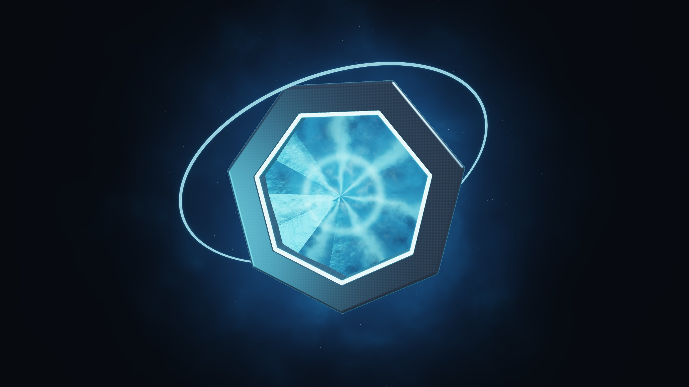

<div align="center">


<br />

# Luma OS 1.7.1 — **Oxygen · O-8**

**Настольная оболочка нового поколения для Windows 10 / 11 на ядре `LumaCore 1.6.1`, антивирусе `LumaShield 3.2` (340+ правил · Anti-RAT · USB Shield) и ИИ `Luma Ai Nitrogen`: полноэкранная волна передачи файлов в стиле HarmonyOS (приём и отправка на ПК и телефоне), ультра-простой 1-тап интерфейс Android `Oxygen Connect`, ускоренный плавный тачпад, полноценный мультимодальный аналог `Circle to Search` (ПК и смартфон), KWin-правила окон, полка Dropzone, Умный буфер (OCR), Per-App Аудио-центр и капсульные OSD**

<p>
  <a href="https://github.com/Tveexty/L_H-3.0/releases/tag/v1.7.1"></a>
  
  
  
  
  
</p>

<h3>
  <a href="https://github.com/Tveexty/L_H-3.0/raw/main/LumaOS_1.7.1.exe">⬇️ Скачать LumaOS_1.7.1.exe (Oxygen 1.7.1 · 1 файл)</a>
  &nbsp;&nbsp;·&nbsp;&nbsp;
  <a href="https://github.com/Tveexty/L_H-3.0/releases/tag/v1.7.1">📦 Релиз v1.7.1</a>
  &nbsp;&nbsp;·&nbsp;&nbsp;
  <a href="PATCH_NOTES_1.7.1.md">📝 Патч-ноут 1.7.1</a>
  &nbsp;&nbsp;·&nbsp;&nbsp;
  <a href="LumaOxygenConnect_Android/README.md">📱 Oxygen Connect (Android)</a>
  &nbsp;&nbsp;·&nbsp;&nbsp;
  <a href="luma_ai_nitrogen/README.md">🧠 Luma Ai Nitrogen</a>
</h3>

</div>

> [!WARNING]
> **⚠️ Нестабильная работа версий `1.6.4` – `1.6.6b`!**
> Сборки **`1.6.4`**, **`1.6.5`**, **`1.6.6`** и **`1.6.6b`** работают **нестабильно** — **не используйте их**. Скачивайте актуальную версию **[Luma OS 1.7.1 (Oxygen)](https://github.com/Tveexty/L_H-3.0/releases/tag/v1.7.1)** (или финальную стабильную сборку ветки `1.6.x` — [`LumaOS_1.6.7.exe`](https://github.com/Tveexty/L_H-3.0/releases/tag/v1.6.7)).

---

## Что нового в **Luma OS 1.7.1 (Oxygen · O-8 · `LumaCore 1.6.1` · `LumaShield 3.2`)**

| Модуль | Ключевые возможности и обновления 1.7.1 (Oxygen) |
| :--- | :--- |
| **🌊 Полноэкранная волна передачи (HarmonyOS)** | При каждом **приёме** и **отправке** файла на **ПК (`Luma OS`)** и на **телефоне (`Oxygen Connect`)** от центра экрана расходится светящаяся круговая волна по всему экрану (3 концентрических кольца, радиальное свечение, 16 световых частиц, стеклянная карточка файла с превью, мягкий звук и виброотклик на Android). Работает в реальном времени через SSE (`/api/kernel/oxygen-connect/events`), включая отправку ПК → телефон (`📤 Отправить файл на телефон`) и Полку Dropzone. |
| **📱 Ультра-простой 1-тап интерфейс на телефоне** | Веб-клиент `Oxygen Connect` (`:49218`) полностью пересобран в один чистый экран без вкладок и лишних нажатий: 4 крупные плитки в 1 тап (**«📸 Фото на ПК»**, **«📁 Файл на ПК»**, **«🔍 Circle to Search»**, **«📋 Общий буфер»**), автоматически появляющаяся карточка входящих файлов с ПК и прямой тачпад + громкость/медиа прямо на главном экране. |
| **🖱️ Ускоренный плавный тачпад с телефона** | Базовая чувствительность ускорена с адаптивным ускорением указателя (`pointer acceleration`), частотой обновления `14 мс` (~70 Гц), быстрым переключателем скорости **`1.0× / 1.4× / 2.0×`** (по умолчанию **`1.4×`**), тапом двумя пальцами для ПКМ и плавным скроллом двумя пальцами. |
| **🔍 Полноценный аналог Circle to Search (ПК и телефон)** | Мультимодальный визуальный анализ выделенной пальцем или лассо области экрана через `/api/kernel/lens/circle-search` и мобильный `/api/circle-search` с потоковым ответом (SSE): Gemini Vision (`inline_data`) / OpenAI Vision (`image_url`) + встроенный офлайн/веб-движок. Строгий формат ответов без воды: **Товар/предмет** (бренд, модель, характеристики), **Текст/документ** (точное извлечение + автоперевод на русский + термины), **Ошибка/код** (причина + шаг исправления), **Место** (название, город, страна), **Математика** (пошаговое решение + ответ) и честные 2–3 варианта при размытом кадре. На смартфоне работает и с **фото/камеры телефона**, и с **живого экрана ПК**! |
| **Всё лучшее из Oxygen 1.7 внутри** | 100% прогрузка всех иконок, умный автозапуск самой новой сборки, KWin-правила окон, навсегда починенный `Alt+Tab`, Полка Drag & Drop (`Ctrl+Alt+S`), Умный буфер обмена с категориями и Auto-OCR (`Ctrl+Shift+V`), Per-App Аудио-центр в Панели управления, капсульные OSD, 2.5D обои Oxygen и 60 FPS мини-игра «Oxygen Pulse». |

---

## Все ключевые возможности экосистемы **Luma OS**

- **Модульный ИИ `Luma Ai Nitrogen` (`luma_ai_nitrogen/`):** универсальный клиент (Ollama `qwen2.5:3b` / `llama3.2:3b`, Google Gemini Vision/SSE, OpenAI, Claude, Groq, OpenRouter), SSE-стриминг, 3-уровневая память (SQLite WAL + RAG), интеграция с Офисом, Календарём и **Circle to Search**, установка/удаление локального ИИ в 1 клик.
- **Антивирус `LumaShield 3.2` (Zero-Freeze · 340+ правил):** Anti-RAT уничтожение под ноль, Щит USB-флешек, блокировка чужих файлов, нативный Win32 выбор файла (`< 15 мс`, лимит 4 МБ без фризов), аудит автозагрузки и планировщика задач.
- **Нативный `Dynamic Island` поверх Chrome и всех окон Windows, рамочное выделение ЛКМ на рабочем столе и 36 языков интерфейса + 120+ раскладок.**
- **100% нативные Wi-Fi и Bluetooth (ПКМ + пароль), замена горячих клавиш (`Win`, `Alt+Tab`, `Win+D`), Win32 HID жесты Precision Touchpad, магнитный `Dock`, пружинные анимации, `Luma Office Pro` (Word A4 / 140+ формул Excel / PowerPoint), `Luma SwapBoost`, `Gamepad Studio`, `Deep Uninstaller` и `Luma Peek` (`Space`).**

---

## Галерея обоев **Oxygen 1.7.1 + Nitrogen (21 встроенный арт)**

> Все **21** обои встроены прямо в `LumaOS_1.7.1.exe` (включая полную коллекцию предыдущих версий).

<table>
  <tr>
    <td width="33%" align="center">
      
      <br />
      <b>Oxygen — 2.5D Cryo-Bubbles (Главные)</b>
    </td>
    <td width="33%" align="center">
      
      <br />
      <b>Nitrogen — 2.5D Cryo-Glass</b>
    </td>
    <td width="33%" align="center">
      
      <br />
      <b>Nitrogen — N-7 Monolith</b>
    </td>
  </tr>
  <tr>
    <td width="33%" align="center">
      
      <br />
      <b>Nitrogen Aurora</b>
    </td>
    <td width="33%" align="center">
      
      <br />
      <b>Nitrogen Glacier</b>
    </td>
    <td width="33%" align="center">
      
      <br />
      <b>Nitrogen Alpine</b>
    </td>
  </tr>
</table>

---

## Скачать Luma OS (все 29 сборок сохранены)

Все исполняемые файлы автономны (**Single-Binary Portable EXE** — встроенный фронтенд + Go-ядро, установка не требуется):

| Версия | Кодовое имя | Ядро / Возможности | Прямая ссылка |
| :--- | :--- | :--- | :--- |
| **1.7.1 (Актуальная)** | **Oxygen · O-8** | `LumaCore 1.6.1` · `LumaShield 3.2` · `🌊 Полноэкранная волна HarmonyOS (приём/отправка)` · `📱 1-Тап UI телефона` · `🖱️ Ускоренный тачпад 1.4×` · `🔍 Полноценный Circle to Search (ПК + смартфон)` | [**LumaOS_1.7.1.exe**](https://github.com/Tveexty/L_H-3.0/raw/main/LumaOS_1.7.1.exe) |
| **1.7** | **Oxygen · O-8** | `LumaCore 1.6.0` · `LumaShield 3.2` · `100% Иконки` · `Умный автозапуск` · `KWin Правила окон` · `Фикс Alt+Tab` · `Полка Dropzone` · `Умный буфер (OCR)` · `Per-App Аудио` · `Капсульные OSD` · `Oxygen Connect (Android)` | [LumaOS_1.7.exe](https://github.com/Tveexty/L_H-3.0/raw/main/LumaOS_1.7.exe) |
| **1.6.7 (Финал 1.6.x)** | **Nitrogen · N-7** | `LumaCore 1.5.7` · `LumaShield 3.1` · `Фикс курсора/кликов Dynamic Island` · `Нативный Zero-Freeze выбор файла` · `old protatips/` | [LumaOS_1.6.7.exe](https://github.com/Tveexty/L_H-3.0/raw/main/LumaOS_1.6.7.exe) |
| ~~1.6.6b~~ *(нестаб.)* | Nitrogen · N-7 | `LumaCore 1.5.6b` · *Нестабильная ветка 1.6.4–1.6.6b (используйте 1.7.1 / 1.6.7)* | [LumaOS_1.6.6b.exe](https://github.com/Tveexty/L_H-3.0/raw/main/LumaOS_1.6.6b.exe) |
| ~~1.6.6~~ *(нестаб.)* | Nitrogen · N-7 | `LumaCore 1.5.6` · *Нестабильная ветка 1.6.4–1.6.6b (используйте 1.7.1 / 1.6.7)* | [LumaOS_1.6.6.exe](https://github.com/Tveexty/L_H-3.0/raw/main/LumaOS_1.6.6.exe) |
| ~~1.6.5~~ *(нестаб.)* | Nitrogen · N-7 | `LumaCore 1.5.5` · *Нестабильная ветка 1.6.4–1.6.6b (используйте 1.7.1 / 1.6.7)* | [LumaOS_1.6.5.exe](https://github.com/Tveexty/L_H-3.0/raw/main/LumaOS_1.6.5.exe) |
| ~~1.6.4~~ *(нестаб.)* | Nitrogen · N-7 | `LumaCore 1.5.4` · *Нестабильная ветка 1.6.4–1.6.6b (используйте 1.7.1 / 1.6.7)* | [LumaOS_1.6.4.exe](https://github.com/Tveexty/L_H-3.0/raw/main/LumaOS_1.6.4.exe) |
| **1.6.3** | Nitrogen · N-7 | `LumaCore 1.5.3` · `Luma Ai Nitrogen (SSE + 3-Tier RAG)` · `Установить/Удалить ИИ` · `Стоп-зарядка АКБ` · `Touch & Stylus` · `Word A4` · `📌 Поверх Chrome` | [LumaOS_1.6.3.exe](https://github.com/Tveexty/L_H-3.0/raw/main/LumaOS_1.6.3.exe) |
| **1.6.2b** | Nitrogen · N-7 | `LumaCore 1.5.2b` · `Нативные Wi-Fi & Bluetooth (ПКМ + пароль)` · `Замена горячих клавиш + Тачпад` · `0 всплытий Настроек Windows` | [LumaOS_1.6.2b.exe](https://github.com/Tveexty/L_H-3.0/raw/main/LumaOS_1.6.2b.exe) |
| **1.6.2** | Nitrogen · N-7 | `LumaCore 1.5.2` · `Luma AI 5.0 Nexus` · `Luma Обвести для поиска` · `Жесты & Спецвозможности` · `Live Загрузки` · `Безопасная Корзина` | [LumaOS_1.6.2.exe](https://github.com/Tveexty/L_H-3.0/raw/main/LumaOS_1.6.2.exe) |
| **1.6.1** | Nitrogen · N-7 | `LumaCore 1.5.1` · `LumaShield 2.5` · `Luma AI 4.0` · `2.5D Cryo-Glass` · `Hover Smart Dock` · `Luma Nova` | [LumaOS_1.6.1.exe](https://github.com/Tveexty/L_H-3.0/raw/main/LumaOS_1.6.1.exe) |
| **1.6** | Nitrogen · N-7 | `LumaCore 1.5.0` · `LumaShield 2.5` · `Gamepad Studio` · `Deep Uninstaller` · `Luma Peek` · `Smart Dock` | [LumaOS_1.6.exe](https://github.com/Tveexty/L_H-3.0/raw/main/LumaOS_1.6.exe) |
| **1.5.4** | Carbon · C-6 | `LumaCore 1.4.7` · `24/7 Stability` · `Шторка` · `140+ Excel` · `Battery Care` | [LumaOS_1.5.4.exe](https://github.com/Tveexty/L_H-3.0/raw/main/LumaOS_1.5.4.exe) |
| **1.5.3** | Carbon · C-6 | `LumaCore 1.4.6` · `Topmost Alt+Tab` · `Luma Office Pro` · `Idle Sleep` | [LumaOS_1.5.3.exe](https://github.com/Tveexty/L_H-3.0/raw/main/LumaOS_1.5.3.exe) |
| **1.5.2** | Carbon · C-6 | `LumaCore 1.4.5` · `LumaShield 2.0` · `Studios Pro` · `AI 3.0` | [LumaOS_1.5.2.exe](https://github.com/Tveexty/L_H-3.0/raw/main/LumaOS_1.5.2.exe) |
| **1.5.1** | Carbon · C-6 | `LumaCore 1.6.1` · `LumaShield 2.0` · `Office Studio` | [LumaOS_1.5.1.exe](https://github.com/Tveexty/L_H-3.0/raw/main/LumaOS_1.5.1.exe) |
| **1.5** | Carbon · C-6 | `LumaCore 1.6` · `LumaShield 1.6` · `AES-256 Vault` | [LumaOS_1.5.exe](https://github.com/Tveexty/L_H-3.0/raw/main/LumaOS_1.5.exe) |
| **1.4** | Boron · B-5 | `LumaCore 1.5` · `LumaShield 1.5` · `SDK v3.0` | [LumaOS_1.4.exe](https://github.com/Tveexty/L_H-3.0/raw/main/LumaOS_1.4.exe) |
| **1.3.1** | Beryllium · Be-4 | `LumaCore 1.4` · `LumaShield 1.4` | [LumaOS_1.3.1.exe](https://github.com/Tveexty/L_H-3.0/raw/main/LumaOS_1.3.1.exe) |
| **1.3** | Beryllium · Be-4 | `LumaCore 1.4` · `LumaShield 1.4` | [LumaOS_1.3.exe](https://github.com/Tveexty/L_H-3.0/raw/main/LumaOS_1.3.exe) |
| **1.2.3B** | Lithium · Li-3 | `LumaCore 1.3B` (True Zero-WMI) | [LumaOS_1.2.3B.exe](https://github.com/Tveexty/L_H-3.0/raw/main/LumaOS_1.2.3B.exe) |
| **1.2.3** | Lithium · Li-3 | `LumaCore 1.3` · `LumaShield 1.3` | [LumaOS_1.2.3.exe](https://github.com/Tveexty/L_H-3.0/raw/main/LumaOS_1.2.3.exe) |
| **1.2.2** | Lithium · Li-3 | `LumaCore 1.2.2` · `LumaShield 1.3` | [LumaOS_1.2.2.exe](https://github.com/Tveexty/L_H-3.0/raw/main/LumaOS_1.2.2.exe) |
| **1.2.1** | Lithium · Li-3 | `LumaCore 1.2` | [LumaOS_1.2.1.exe](https://github.com/Tveexty/L_H-3.0/raw/main/LumaOS_1.2.1.exe) |
| **1.2.0** | Lithium · Li-3 | `LumaCore 1.2` | [LumaOS_1.2.0.exe](https://github.com/Tveexty/L_H-3.0/raw/main/LumaOS_1.2.0.exe) |
| **1.1.0** | Helium · He-2 | `LumaCore 1.1` | [LumaOS_1.1.0.exe](https://github.com/Tveexty/L_H-3.0/raw/main/LumaOS_1.1.0.exe) |
| **1.0.4** | Luma Classic | `LumaCore 1.0` | [LumaOS_1.0.4.exe](https://github.com/Tveexty/L_H-3.0/raw/main/LumaOS_1.0.4.exe) |
| **1.0.3** | Luma Classic | `LumaCore 1.0` | [LumaOS_1.0.3.exe](https://github.com/Tveexty/L_H-3.0/raw/main/LumaOS_1.0.3.exe) |
| **1.0.2b** | Luma Classic | `LumaCore 1.0` | [LumaOS_1.0.2b.exe](https://github.com/Tveexty/L_H-3.0/raw/main/LumaOS_1.0.2b.exe) |

---

## Сборка из исходников

```bash
npm install
npm run build
GOOS=windows GOARCH=amd64 CGO_ENABLED=0 go build -ldflags="-s -w -H=windowsgui" -o LumaOS_1.7.1.exe .
```

## Запуск отдельного модуля `Luma Ai Nitrogen` (Python FastAPI + Ollama / Gemini)

```bash
cd luma_ai_nitrogen
python -m venv .venv && .venv\Scripts\activate   # Linux/macOS: source .venv/bin/activate
pip install -r requirements.txt
cp .env.example .env
ollama pull qwen2.5:3b
python main.py --mode server                     # или --mode cli для интерактивного чата
```
