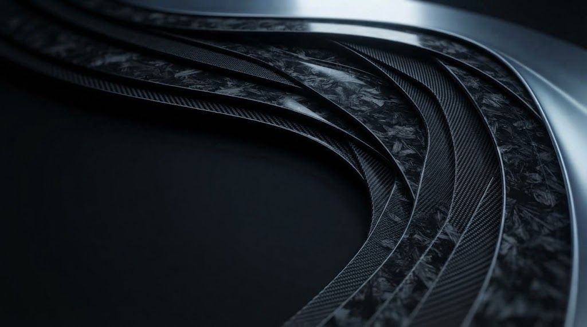
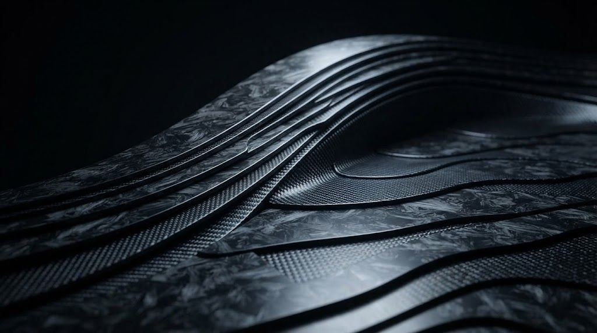

<div align="center">


<br />

# Luma OS 1.5 — **Carbon · C-6**

**Флагманская настольная операционная среда для Windows 10 / 11 на нативном Zero-WMI ядре `LumaCore 1.6` и модуле защиты `LumaShield 1.6`**

<p>
  <a href="https://github.com/Tveexty/L_H-3.0/releases/tag/v1.5"></a>
  
  
  
  
</p>

<h3>
  <a href="https://github.com/Tveexty/L_H-3.0/raw/main/LumaOS_1.5.exe">⬇️ Скачать LumaOS_1.5.exe (Portable · 1 файл · 0 зависимостей)</a>
  &nbsp;&nbsp;·&nbsp;&nbsp;
  <a href="https://github.com/Tveexty/L_H-3.0/releases/tag/v1.5">📦 Страница релиза v1.5</a>
</h3>

</div>

---

## Что нового в **Luma OS 1.5 (Carbon · C-6)**

| Модуль | Ключевые возможности релиза 1.5 |
| :--- | :--- |
| **Панель управления Carbon (`Tab` / правый верхний угол)** | Флагманская выезжающая панель `1/4` ширины × `1/2` высоты экрана — **полностью редактируемая** (добавление, удаление и перестановка плиток), с **Менеджером функций ОС** (вкл/выкл любых системных модулей), сворачиваемыми BT/2.4GHz устройствами и **Единым центром уведомлений** (Telegram + система + фильтры) прямо снизу. |
| **Компактный Скриншот и Запись экрана** | Встроены прямо в Панель управления Carbon: нативный Win32 GDI32 JPEG-снимок (~120 КБ в `~/Pictures/LumaCaptures`) и компактная запись экрана (`WebM VP9/VP8` с выбором качества `Эко 1.2 / Норм 2.5 / HD 5 Мбит/с`, ~9 МБ/мин → `~/Videos/LumaRecordings`). |
| **Суперконфиденциальность (AES-256-GCM Приватный стол)** | Полностью изолированный приватный рабочий стол: шифрует файлы, заметки, ссылки и приложения на диске в `*.lumavault` (недоступно для Проводника Windows и сторонних программ). Работает как **по паролю**, так и **без пароля** (стелс-режим), с экстренной блокировкой `Esc × 2` и Zero-Wipe удалением. |
| **Двойная панель задач + Прямой запуск приложений** | Переключатель в *Настройки → Панель задач*: разделяет оболочку на **2 панели** (верхняя — весь функционал, поиск, трей и часы; нижняя — запущенные и закреплённые программы). Плюс прямой запуск любых программ ПК с панели задач в 1 клик. |
| **Luma Code Studio (IDE в стиле VS Code)** | Полноценная встроенная среда разработки: реальное дерево файлов ПК (`/api/kernel/fs`), мульти-вкладки с нумерацией строк, поиск и замена, сохранение `Ctrl+S` на диск, живой HTML-предпросмотр, запуск JS / Python / Go и встроенный терминал ОС. |
| **Luma Cut Studio (Видеоредактор в стиле CapCut)** | Нелинейный видеоредактор с реальным `<canvas>`-композитором (`16:9`, `9:16`, `1:1`, `4:3`), импортом видео/фото/аудио, мультидорожечным таймлайном (разрез, скорость, дублирование), **10 кино-LUT фильтрами**, цветокоррекцией, анимированными титрами, переходами и реальным экспортом в `.webm`. |
| **Сценарии автоматизации («Если → То»)** | Умные правила автоматизации: запуск приложений, подключение/отключение зарядки, низкий заряд батареи, расписание `ЧЧ:ММ`, смена темы или вход в Приватный сейф → автоматический DND, DPI мыши, план питания, громкость, скриншот, очистка RAM и готовые шаблоны в 1 клик. |
| **Конструктор своих виджетов (Фото + JS скрипт)** | Создавайте собственные виджеты рабочего стола со своей картинкой с диска, настройкой прозрачности/размытия/акцента и живым JS-скриптом с доступом к `ctx.telemetry`, `ctx.wireless`, `ctx.time`, `ctx.weather`. |
| **Мышки IO (Nova SE), Ajazz & Ardor Gaming (2.4GHz HID)** | Нативный Win32 HID-движок опроса батареи по протоколам **Compx CX52850 / JM03** (`0x08`/`0x04`) и **Ajazz** (`0xF7`→`0x05`, `0x20 0x01`) + фильтр USB Wi-Fi адаптеров (`TP-Link MU-MIMO` и др.) + сворачиваемая кнопка **«Скрыть / Показать»** в списке BT/2.4GHz устройств + новый виджет **«Заряд ПК и всей периферии (1.5)»**. |
| **Системная Корзина + «3 точки» окна + HarmonyOS 7 + Календарь Pro** | Встроенная **Корзина Luma OS** (восстановление и полная очистка вместе с Корзиной Windows), замена кнопок окна на **3 цветные точки (`● ● ●`)** или **1 кнопку «3 точки» (`⋯`)**, анимации интерфейса и распада при удалении в стиле **HarmonyOS 7**, стили **«Классический»** и **«Модерн»** и обновлённый Календарь (Месяц / Неделя / Повестка / Повторы / Приоритеты / Pomodoro / `.ics`). |

---

## Галерея новых обоев **Carbon 1.5**

> Все обои встроены в `LumaOS_1.5.exe` и дополняют полную коллекцию предыдущих версий (`Boron 1.4`, `Beryllium 1.3.1`, `Lithium 1.2`, `Obsidian Silk`, `Helium 1.1` + 10 живых CSS-обоев).

<table>
  <tr>
    <td width="33%" align="center">
      
      <br />
      <b>Carbon 1.5 — 3D Monolith</b>
    </td>
    <td width="33%" align="center">
      
      <br />
      <b>Carbon Weave Ribbons</b>
    </td>
    <td width="33%" align="center">
      
      <br />
      <b>Forged Carbon Flow</b>
    </td>
  </tr>
</table>

---

## Новые API ядра `LumaCore 1.6`

| Метод и эндпоинт | Назначение |
| :--- | :--- |
| `GET / POST /api/kernel/trash` | Системная Корзина Luma OS (`move` / `restore` / `delete` / `empty` + Win32 `SHEmptyRecycleBinW`) |
| `GET /api/kernel/vault/status` | Статус контейнера Суперконфиденциальности (`AES-256-GCM`) |
| `POST /api/kernel/vault/auth` | Настройка режима входа (с паролем / без пароля), разблокировка и блокировка сейфа |
| `GET / POST /api/kernel/vault/items` | Добавление, шифрование (`*.lumavault`), чтение в RAM и Zero-Wipe удаление объектов сейфа |
| `POST /api/kernel/capture/screenshot` | Нативный компактный Win32 GDI32 JPEG-скриншот (`~/Pictures/LumaCaptures`) |
| `POST /api/kernel/capture/save-recording` | Сохранение компактной записи экрана `.webm` (`~/Videos/LumaRecordings`) |
| `GET /api/kernel/wireless/batteries?refresh=1` | Сканер Bluetooth, BLE и 2.4GHz мышек **IO (Nova SE)**, **Ajazz**, **Ardor Gaming**, **Logitech**, **Razer** и др. |
| `GET / POST / DELETE /api/v3/themes` & `/api/v3/plugins` | Developer SDK v3.0 — установка пользовательских тем и плагинов |

---

## Горячие клавиши

| Комбинация | Действие |
| :--- | :--- |
| `Tab` (или правый верхний угол) | **Панель управления Carbon (`1/4 × 1/2`)** + Единый центр уведомлений |
| `Alt + R` / `Ctrl + K` | **Luma Search** — мгновенный поиск приложений ПК, настроек, студий, сейфа и веба |
| `Esc × 2` (внутри сейфа) | Экстренная блокировка **Суперконфиденциальности** |
| `Alt + Shift` / `Win + Space` | Мгновенная смена раскладки клавиатуры |
| `Alt + W` | Обзор открытых окон и виртуальных рабочих столов |
| `Alt + D` | Свернуть все окна / показать рабочий стол |
| `F11` | Полноэкранный режим оболочки |
| `Ctrl + Alt + Shift + W` | Экстренное восстановление системной панели задач Windows |

---

## Скачать Luma OS (все сборки)

Все исполняемые файлы автономны (**Single-Binary Portable EXE** — встроенный фронтенд + Go-ядро, установка не требуется):

| Версия | Кодовое имя | Ядро / Защита | Прямая ссылка |
| :--- | :--- | :--- | :--- |
| **1.5 (Актуальная)** | **Carbon · C-6** | `LumaCore 1.6` · `LumaShield 1.6` · `AES-256 Vault` | [**LumaOS_1.5.exe**](https://github.com/Tveexty/L_H-3.0/raw/main/LumaOS_1.5.exe) |
| **1.4** | Boron · B-5 | `LumaCore 1.5` · `LumaShield 1.5` · `SDK v3.0` | [LumaOS_1.4.exe](https://github.com/Tveexty/L_H-3.0/raw/main/LumaOS_1.4.exe) |
| **1.3.1** | Beryllium · Be-4 | `LumaCore 1.4` · `LumaShield 1.4` | [LumaOS_1.3.1.exe](https://github.com/Tveexty/L_H-3.0/raw/main/LumaOS_1.3.1.exe) |
| **1.3** | Beryllium · Be-4 | `LumaCore 1.4` · `LumaShield 1.4` | [LumaOS_1.3.exe](https://github.com/Tveexty/L_H-3.0/raw/main/LumaOS_1.3.exe) |
| **1.2.3B** | Lithium · Li-3 | `LumaCore 1.3B` (True Zero-WMI) | [LumaOS_1.2.3B.exe](https://github.com/Tveexty/L_H-3.0/raw/main/LumaOS_1.2.3B.exe) |
| **1.2.3** | Lithium · Li-3 | `LumaCore 1.3` · `LumaShield 1.3` | [LumaOS_1.2.3.exe](https://github.com/Tveexty/L_H-3.0/raw/main/LumaOS_1.2.3.exe) |
| **1.2.2** | Lithium · Li-3 | `LumaCore 1.2.2` · `LumaShield 1.3` | [LumaOS_1.2.2.exe](https://github.com/Tveexty/L_H-3.0/raw/main/LumaOS_1.2.2.exe) |
| **1.2.1** | Lithium · Li-3 | `LumaCore 1.2` | [LumaOS_1.2.1.exe](https://github.com/Tveexty/L_H-3.0/raw/main/LumaOS_1.2.1.exe) |
| **1.2** | Lithium · Li-3 | `LumaCore 1.2` | [LumaOS_1.2.exe](https://github.com/Tveexty/L_H-3.0/raw/main/LumaOS_1.2.exe) |
| **1.1** | Helium · He-2 | `LumaCore 1.1` | [LumaOS_1.1.exe](https://github.com/Tveexty/L_H-3.0/raw/main/LumaOS_1.1.exe) |
| **1.0.4** | Classic DeX | `LumaCore 1.0` | [LumaOS_1.0.4.exe](https://github.com/Tveexty/L_H-3.0/raw/main/LumaOS_1.0.4.exe) |

---

## Сборка из исходников

```bash
npm install
npm run build
GOOS=windows GOARCH=amd64 CGO_ENABLED=0 go build -ldflags="-s -w -H=windowsgui" -o LumaOS_1.5.exe .
```
