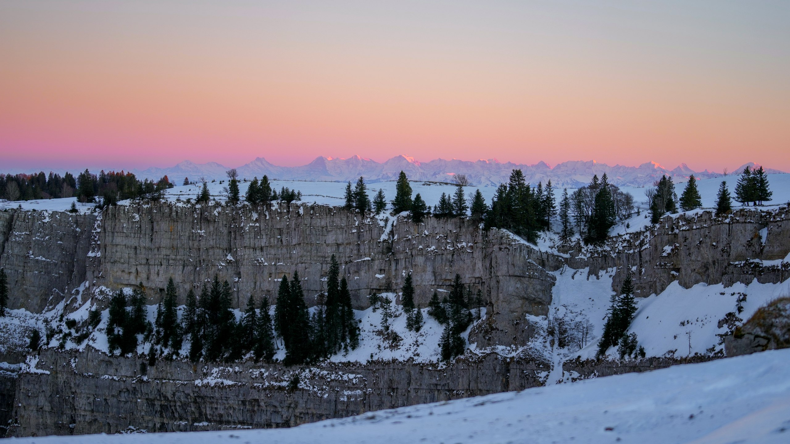

<div align="center">


<br />

# Luma OS 1.6.7 — **Nitrogen · Final 1.6.x**

**Финальная стабильная сборка ветки `1.6.x` для Windows 10 / 11 на ядре `LumaCore 1.5.7`, антивирусе `LumaShield 3.1 Zero-Freeze` (340+ правил · Anti-RAT уничтожение под ноль · Щит USB-флешек) и ИИ `Luma Ai Nitrogen`: починен Dynamic Island поверх Chrome и окон Windows (без «окошка загрузки» вместо курсора), исправлено зависание проводника при проверке отдельного файла, наведён порядок в репозитории (`old protatips`)**

<p>
  <a href="https://github.com/Tveexty/L_H-3.0/releases/tag/v1.6.7"></a>
  
  
  
  
  
</p>

<h3>
  <a href="https://github.com/Tveexty/L_H-3.0/raw/main/LumaOS_1.6.7.exe">⬇️ Скачать LumaOS_1.6.7.exe (Стабильная · Финал 1.6.x · 1 файл)</a>
  &nbsp;&nbsp;·&nbsp;&nbsp;
  <a href="https://github.com/Tveexty/L_H-3.0/releases/tag/v1.6.7">📦 Релиз v1.6.7</a>
  &nbsp;&nbsp;·&nbsp;&nbsp;
  <a href="PATCH_NOTES_1.6.7.md">📝 Патч-ноут 1.6.7</a>
  &nbsp;&nbsp;·&nbsp;&nbsp;
  <a href="luma_ai_nitrogen/README.md">🧠 Модуль Luma Ai Nitrogen</a>
</h3>

</div>

> [!WARNING]
> **⚠️ Нестабильная работа версий `1.6.4` – `1.6.6b`!**
> Сборки **`1.6.4`**, **`1.6.5`**, **`1.6.6`** и **`1.6.6b`** работают **нестабильно** (зависание при выборе файла в антивирусе, зависший курсор загрузки на Dynamic Island поверх Chrome/Windows и фризы сканера). Пожалуйста, **не используйте `1.6.4–1.6.6b`** — скачивайте финальную стабильную сборку **[Luma OS 1.6.7](https://github.com/Tveexty/L_H-3.0/releases/tag/v1.6.7)**!

---

## Что нового в **Luma OS 1.6.7 (Nitrogen · Final 1.6.x · `LumaCore 1.5.7` · `LumaShield 3.1`)**

| Модуль | Ключевые исправления и возможности 1.6.7 |
| :--- | :--- |
| **Фикс Dynamic Island в Chrome / Windows** | Полностью устранено «окошко загрузки» вместо курсора и неработающие клики: в нативный Win32-оверлей добавлены системные курсоры `IDC_ARROW`/`IDC_HAND`, обработка `WM_SETCURSOR`, `WM_NCHITTEST` (`HTCLIENT`) и `WM_CAPTURECHANGED`, а из периодического таймера убран сбивающий клики флаг `SWP_SHOWWINDOW`. |
| **Фикс проводника и проверки файла (`LumaShield 3.1`)** | Устранено критическое зависание всей системы при поиске и выборе файла в антивирусе: прямой нативный Win32 `GetOpenFileNameW` (`< 15 мс`, 0% PowerShell), `TopMost` выбор папок с таймаутом 90 сек, отдельные кнопки **«Выбрать файл»** и **«Папка»**, лимит чтения **4 МБ** на диске и **2 МБ** при Drag-and-Drop (исключён краш WebView2/ОЗУ) + Anti-RAT проверка одиночного файла. |
| **Zero-Freeze сканер и таймауты ядра** | Быстрый `filepath.WalkDir` (`8/14 сек`), пропуск OneDrive/симлинков, кэш USB-флешек (`0% CPU`, 20 сек), асинхронный статус Defender (`< 5 мс`), кнопка **«Остановить»** и таймаут 6 сек в аудите планировщика задач (`AuditScheduledTasks`). |
| **Рамочное выделение ЛКМ + 36 языков** | Выделение группы элементов ЛКМ на рабочем столе (перетаскивание, сбор в папку, ПКМ, Delete) и 36 языков интерфейса системы с мгновенным поиском и автопереводом. |
| **Чистый репозиторий (`old protatips/`)** | Все устаревшие прототипы (`launcher_hab2.4`, `LauncherHab3.0_CSharp`, `Luma_Core`, `start_all.bat`, `metadata.json`) перенесены в папку **`old protatips/`**. |

---

## Все флагманские возможности ветки **1.6.x (Nitrogen · N-7)**

- **Переключатель «Пружинные анимации во всей системе»** в *Настройки → Панель задач* и в ПКМ-меню самой панели задач.
- **Модульный ИИ `Luma Ai Nitrogen` (`luma_ai_nitrogen/`):** универсальный клиент (Ollama `qwen2.5:3b` / `llama3.2:3b`, Google Gemini SSE/OpenAI, OpenAI, Claude, Groq, OpenRouter), SSE-стриминг, 3-уровневая память (SQLite WAL + RAG), Function Calling, интеграция с Офисом, Календарём и «Обвести для поиска», а также установка/удаление локального ИИ в 1 клик.
- **100% нативные Wi-Fi и Bluetooth (ПКМ + ввод пароля + поиск всех устройств рядом):** управление адаптерами, выбор сетей, ввод пароля Wi-Fi / PIN Bluetooth без открытия Настроек Windows.
- **Замена горячих клавиш (`Win`, `Alt + Tab`, `Win + D`) и нативные Win32 HID жесты Precision Touchpad:** единый переключатель в *Настройки → Оболочка Windows* с полным автовосстановлением по `Ctrl + Alt + Shift + W` и при выходе.
- **Авто-скрытие визуального шума и интерактивный магнитный `Dock`:** растворение панелей при просмотре видео и в `F11`, гауссово притяжение иконок, пружинный отскок и ореол прогресса загрузок/рендера.
- **Luma Обвести для поиска (`Ctrl + Shift + L`):** захват экрана, свободное обведение лассо мышью/пальцем/стилусом, офлайн-OCR (`RU+EN`), палитра цветов, перевод и потоковый разбор через `Luma Ai Nitrogen`.
- **Стоп-зарядка батареи ноутбука, Touch & Stylus, постраничный A4 Word, «Обзор окон» в Пуске и реальное `📌 Поверх всех окон` поверх Chrome.**
- **`Luma SwapBoost` (2 / 4 / 6 ГБ), `Luma Gamepad Studio`, `Luma Deep Uninstaller`, `Luma Peek` (`Space`):** нативные утилиты на ядре `LumaCore 1.5.6` и защите `LumaShield 2.5` (275 правил, 113 API-маршрутов, 0 утечек Win32-колбэков).

---

## Галерея обоев **Nitrogen (QHD 2560×1440)**

> Все 20 обоев встроены в `LumaOS_1.6.6.exe` (включая полную коллекцию предыдущих версий).

<table>
  <tr>
    <td width="33%" align="center">
      
      <br />
      <b>Nitrogen — 2.5D Cryo-Glass (Главные)</b>
    </td>
    <td width="33%" align="center">
      
      <br />
      <b>Nitrogen — N-7 Monolith</b>
    </td>
    <td width="33%" align="center">
      
      <br />
      <b>Nitrogen Aurora</b>
    </td>
  </tr>
  <tr>
    <td width="33%" align="center">
      
      <br />
      <b>Nitrogen Glacier</b>
    </td>
    <td width="33%" align="center">
      
      <br />
      <b>Nitrogen Alpine</b>
    </td>
    <td width="33%" align="center">
      
      <br />
      <b>Nitrogen Fjord</b>
    </td>
  </tr>
</table>

---

## Скачать Luma OS (все 25 сборок сохранены)

Все исполняемые файлы автономны (**Single-Binary Portable EXE** — встроенный фронтенд + Go-ядро, установка не требуется):

| Версия | Кодовое имя | Ядро / Возможности | Прямая ссылка |
| :--- | :--- | :--- | :--- |
| **1.6.6 (Актуальная)** | **Nitrogen · N-7** | `LumaCore 1.5.6` · `Выделение ЛКМ на рабочем столе` · `36 языков ОС` · `Нативный Dynamic Island поверх Chrome и Windows` · `15+ настроек Острова` | [**LumaOS_1.6.6.exe**](https://github.com/Tveexty/L_H-3.0/raw/main/LumaOS_1.6.6.exe) |
| **1.6.5** | Nitrogen · N-7 | `LumaCore 1.5.5` · `Переключатель пружинных анимаций` · `Фикс Win32 HID Precision Touchpad` · `Изоляция ключей ИИ` · `Пружинный Maximize + Dock без обрезки` · `go vet 0` | [LumaOS_1.6.5.exe](https://github.com/Tveexty/L_H-3.0/raw/main/LumaOS_1.6.5.exe) |
| **1.6.4** | Nitrogen · N-7 | `LumaCore 1.5.4` · `Win32 HID Жесты` · `Gemini SSE/OpenAI Fix` · `Авто-скрытие шума` · `Магнитный Dock + Рендер` · `Пружинная физика` · `Новый OTA-экран` | [LumaOS_1.6.4.exe](https://github.com/Tveexty/L_H-3.0/raw/main/LumaOS_1.6.4.exe) |
| **1.6.3** | Nitrogen · N-7 | `LumaCore 1.5.3` · `Luma Ai Nitrogen (SSE + 3-Tier RAG)` · `Установить/Удалить ИИ` · `Стоп-зарядка АКБ` · `Touch & Stylus` · `Word A4` · `📌 Поверх Chrome` | [LumaOS_1.6.3.exe](https://github.com/Tveexty/L_H-3.0/raw/main/LumaOS_1.6.3.exe) |
| **1.6.2b** | Nitrogen · N-7 | `LumaCore 1.5.2b` · `Нативные Wi-Fi & Bluetooth (ПКМ + пароль)` · `Замена горячих клавиш + Тачпад` · `0 всплытий Настроек Windows` | [LumaOS_1.6.2b.exe](https://github.com/Tveexty/L_H-3.0/raw/main/LumaOS_1.6.2b.exe) |
| **1.6.2** | Nitrogen · N-7 | `LumaCore 1.5.2` · `Luma AI 5.0 Nexus` · `Luma Обвести для поиска` · `Жесты & Спецвозможности` · `Live Загрузки` · `Безопасная Корзина` | [LumaOS_1.6.2.exe](https://github.com/Tveexty/L_H-3.0/raw/main/LumaOS_1.6.2.exe) |
| **1.6.1** | Nitrogen · N-7 | `LumaCore 1.5.1` · `LumaShield 2.5` · `Luma AI 4.0` · `2.5D Cryo-Glass` · `Hover Smart Dock` · `Luma Nova` | [LumaOS_1.6.1.exe](https://github.com/Tveexty/L_H-3.0/raw/main/LumaOS_1.6.1.exe) |
| **1.6** | Nitrogen · N-7 | `LumaCore 1.5.0` · `LumaShield 2.5` · `Gamepad Studio` · `Deep Uninstaller` · `Luma Peek` · `Smart Dock` | [LumaOS_1.6.exe](https://github.com/Tveexty/L_H-3.0/raw/main/LumaOS_1.6.exe) |
| **1.5.4** | Carbon · C-6 | `LumaCore 1.4.7` · `24/7 Stability` · `Шторка` · `140+ Excel` · `Battery Care` | [LumaOS_1.5.4.exe](https://github.com/Tveexty/L_H-3.0/raw/main/LumaOS_1.5.4.exe) |
| **1.5.3** | Carbon · C-6 | `LumaCore 1.4.6` · `Topmost Alt+Tab` · `Luma Office Pro` · `Idle Sleep` | [LumaOS_1.5.3.exe](https://github.com/Tveexty/L_H-3.0/raw/main/LumaOS_1.5.3.exe) |
| **1.5.2** | Carbon · C-6 | `LumaCore 1.4.5` · `LumaShield 2.0` · `Studios Pro` · `AI 3.0` | [LumaOS_1.5.2.exe](https://github.com/Tveexty/L_H-3.0/raw/main/LumaOS_1.5.2.exe) |
| **1.5.1** | Carbon · C-6 | `LumaCore 1.6.1` · `LumaShield 2.0` · `Office Studio` | [LumaOS_1.5.1.exe](https://github.com/Tveexty/L_H-3.0/raw/main/LumaOS_1.5.1.exe) |
| **1.5** | Carbon · C-6 | `LumaCore 1.6` · `LumaShield 1.6` · `AES-256 Vault` | [LumaOS_1.5.exe](https://github.com/Tveexty/L_H-3.0/raw/main/LumaOS_1.5.exe) |
| **1.4** | Boron · B-5 | `LumaCore 1.5` · `LumaShield 1.5` · `SDK v3.0` | [LumaOS_1.4.exe](https://github.com/Tveexty/L_H-3.0/raw/main/LumaOS_1.4.exe) |
| **1.3.1** | Beryllium · Be-4 | `LumaCore 1.4` · `LumaShield 1.4` | [LumaOS_1.3.1.exe](https://github.com/Tveexty/L_H-3.0/raw/main/LumaOS_1.3.1.exe) |
| **1.3** | Beryllium · Be-4 | `LumaCore 1.4` · `LumaShield 1.4` | [LumaOS_1.3.exe](https://github.com/Tveexty/L_H-3.0/raw/main/LumaOS_1.3.exe) |
| **1.2.3B** | Lithium · Li-3 | `LumaCore 1.3B` (True Zero-WMI) | [LumaOS_1.2.3B.exe](https://github.com/Tveexty/L_H-3.0/raw/main/LumaOS_1.2.3B.exe) |
| **1.2.3** | Lithium · Li-3 | `LumaCore 1.3` · `LumaShield 1.3` | [LumaOS_1.2.3.exe](https://github.com/Tveexty/L_H-3.0/raw/main/LumaOS_1.2.3.exe) |
| **1.2.2** | Lithium · Li-3 | `LumaCore 1.2.2` · `LumaShield 1.3` | [LumaOS_1.2.2.exe](https://github.com/Tveexty/L_H-3.0/raw/main/LumaOS_1.2.2.exe) |
| **1.2.1** | Lithium · Li-3 | `LumaCore 1.2` | [LumaOS_1.2.1.exe](https://github.com/Tveexty/L_H-3.0/raw/main/LumaOS_1.2.1.exe) |
| **1.2.0** | Lithium · Li-3 | `LumaCore 1.2` | [LumaOS_1.2.0.exe](https://github.com/Tveexty/L_H-3.0/raw/main/LumaOS_1.2.0.exe) |
| **1.1.0** | Helium · He-2 | `LumaCore 1.1` | [LumaOS_1.1.0.exe](https://github.com/Tveexty/L_H-3.0/raw/main/LumaOS_1.1.0.exe) |
| **1.0.4** | Luma Classic | `LumaCore 1.0` | [LumaOS_1.0.4.exe](https://github.com/Tveexty/L_H-3.0/raw/main/LumaOS_1.0.4.exe) |
| **1.0.3** | Luma Classic | `LumaCore 1.0` | [LumaOS_1.0.3.exe](https://github.com/Tveexty/L_H-3.0/raw/main/LumaOS_1.0.3.exe) |
| **1.0.2b** | Luma Classic | `LumaCore 1.0` | [LumaOS_1.0.2b.exe](https://github.com/Tveexty/L_H-3.0/raw/main/LumaOS_1.0.2b.exe) |

---

## Сборка из исходников

```bash
npm install
npm run build
GOOS=windows GOARCH=amd64 CGO_ENABLED=0 go build -ldflags="-s -w -H=windowsgui" -o LumaOS_1.6.6.exe .
```

## Запуск отдельного модуля `Luma Ai Nitrogen` (Python FastAPI + Ollama / Gemini)

```bash
cd luma_ai_nitrogen
python -m venv .venv && .venv\Scripts\activate   # Linux/macOS: source .venv/bin/activate
pip install -r requirements.txt
cp .env.example .env
ollama pull qwen2.5:3b
python main.py --mode server                     # или --mode cli для интерактивного чата
```
